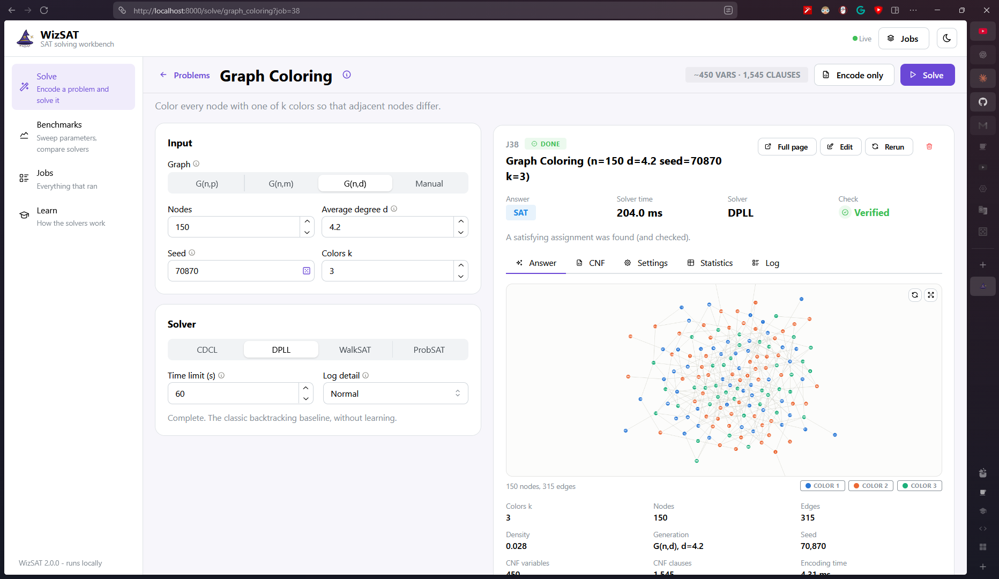
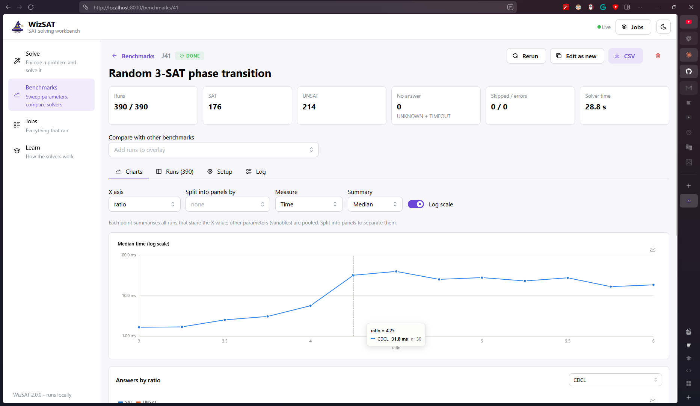
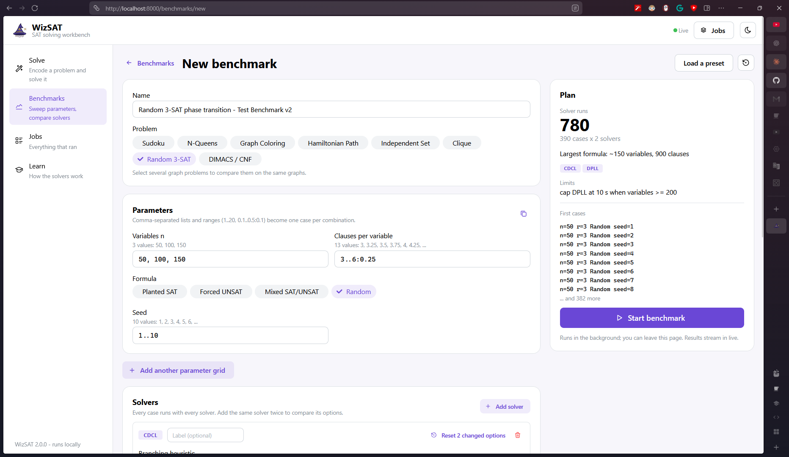

<p align="center">
  
</p>

<h1 align="center">WizSAT</h1>

<p align="center">
  A local SAT-solving workbench: encode classic NP problems as CNF, solve them
  with DPLL, CDCL, WalkSAT or ProbSAT, and benchmark the solvers against each
  other, all from a web page on your own machine.
</p>

---

## What it does

- **Solve** Sudoku, N-Queens, graph coloring, Hamiltonian path, clique,
  independent set, random 3-SAT, or any DIMACS `.cnf` file. The answer is drawn
  on the problem itself (a filled board, a colored graph, a highlighted path)
  and is checked twice: the model must satisfy every clause, and the decoded
  answer must pass the problem's own rules.
- **Look inside the encoding**: the generated CNF, its size, what each variable
  means, the solver statistics and the full solver log, live, on a page of
  its own for each job.
- **Benchmark** solvers on parameter sweeps (`n = 50..200`, ratios
  `3, 3.5, 4.26`, seeds `1..30`, ...), with repeats, time limits and per-solver
  limit rules such as "cap DPLL at 10 s once formulas reach 200 variables".
  Results stream in live and can be charted, filtered, compared across runs
  and exported as CSV. Optionally several cases run at once, one per CPU
  core.
- **Presets** reproduce the report experiments (Random 3-SAT A/B/C) and a few
  classic ones (the 3-SAT phase transition, the 3-coloring threshold, CDCL
  branching heuristics).
- **Learn** how DPLL, CDCL and WalkSAT work with step-by-step interactive
  visualisations and notes.

Everything runs locally. The server listens on `127.0.0.1` only, and jobs and
results are kept in a small SQLite database under `output/`.

## Screenshots







## Requirements

| Tool | Version | Why |
|---|---|---|
| Python | 3.10 or newer | server, encoders and solvers |
| Node.js | 20 or newer (includes `npm`) | builds the web interface once |
| PyPy | 3.10 or newer, optional | runs the solvers faster on long runs ([below](#running-the-solvers-under-pypy)) |

The solvers and encoders are pure Python; the only Python dependencies are
FastAPI and Uvicorn (`requirements.txt`).

## Quick start

Clone the repository, create a virtual environment, install the two Python
dependencies and start the app. The first start installs the web-UI packages
and builds the interface (about a minute); later starts take a second.

**Windows (PowerShell)**

```powershell
git clone https://github.com/Aziyck/SATsolver.git
cd SATsolver
py -m venv .venv
.venv\Scripts\Activate.ps1
python -m pip install -r requirements.txt
python -m sat_web
```

**macOS / Linux**

```bash
git clone https://github.com/Aziyck/SATsolver.git
cd SATsolver
python3 -m venv .venv
source .venv/bin/activate
python -m pip install -r requirements.txt
python -m sat_web
```

The browser opens at `http://localhost:8000` (or the next free port). Stop the
server with `Ctrl+C`. Next time, activate the environment and run
`python -m sat_web` again.

### Launcher options

```text
python -m sat_web                 build the UI if it changed, start, open the browser
python -m sat_web --no-browser    do not open a browser window
python -m sat_web --port 8080     use another port (moves to the next free one if busy)
python -m sat_web --strict-port   exit instead of moving when the port is busy
python -m sat_web --build         force a rebuild of the web UI
python -m sat_web --skip-build    never build (serve whatever is in frontend/dist)
python -m sat_web --dev           auto-reload the Python server while you edit it
python -m sat_web --host NAME     listen on another interface (default: 127.0.0.1, this machine only)
```

Environment variables:

| Variable | Default | Meaning |
|---|---|---|
| `WIZSAT_DATA_DIR` | `output/` | where the job database and job files are stored |
| `WIZSAT_MAX_JOBS` | CPU cores - 1 | jobs that may run at the same time; the rest wait in a queue |
| `WIZSAT_MAX_CLAUSES` | `2000000` | instances larger than this are refused before encoding |
| `WIZSAT_FRONTEND_DIST` | `frontend/dist/` | the built web UI to serve |
| `WIZSAT_ALLOWED_HOSTS` | empty | extra host names, comma-separated, that the server answers for |
| `WIZSAT_SOLVER_PYTHON` | empty | path of another Python (PyPy) to run the solvers in ([below](#running-the-solvers-under-pypy)) |

The server has no login. It answers only requests addressed to `localhost`,
`127.0.0.1` or `[::1]` (any port), the `--host` value and the names in
`WIZSAT_ALLOWED_HOSTS`, and it refuses requests that a page on another
website makes through your browser. With `--host 0.0.0.0`, list the names or
addresses other machines will type, without the port, for example
`WIZSAT_ALLOWED_HOSTS=192.168.1.20,my-pc`.

If Node.js is missing, the server still starts and the page explains how to
build the interface.

### Running the solvers under PyPy

The solvers are plain Python loops, and PyPy runs them about 3 times faster
on runs that take seconds (up to 8 times for DPLL). It is slower on runs
under about half a second, because it needs time to warm up. The server
itself stays on CPython; only the solvers move.

1. Install PyPy 3.10 or newer from <https://pypy.org/download.html>: unpack
   the archive anywhere outside the project, there is no installer. Conda:
   `conda install -c conda-forge pypy3.10`. The solvers use only the standard
   library, so nothing else needs installing in PyPy.
2. Check it: `pypy3 --version` (on Windows, `pypy.exe --version` in the
   unpacked folder).
3. Set `WIZSAT_SOLVER_PYTHON` to its path before starting the app:

```powershell
$env:WIZSAT_SOLVER_PYTHON = "C:\pypy\pypy.exe"; python -m sat_web      # Windows PowerShell
```

```bash
WIZSAT_SOLVER_PYTHON=/opt/pypy3/bin/pypy3 python -m sat_web             # Linux, macOS
```

Every solve and benchmark run then starts in a child process of that
interpreter. Each run pays about 0.3 s to start it, so a benchmark of many
tiny cases gets slower, not faster. The job detail and the CSV name the
interpreter that ran the solvers (`PyPy 7.3.x`), so a result always says what
produced it. Unset the variable to go back. Numbers, the warm-up effect and
what to report: [Solver performance](docs/guide/performance.md#running-the-solvers-under-pypy)
and [Benchmarking](docs/guide/benchmarking.md#checklist-for-report-quality-experiments).

## Using the app

A short tour; the [user guide](docs/guide/user-guide.md) has the details.

1. **Solve**: pick a problem, fill in the form (a live preview shows the
   graph, board or clauses and the CNF size), choose a solver and press
   **Solve**. **Encode only** builds the CNF without solving it, so you can
   download the `.cnf` file.
2. **Benchmarks**: start from a preset or a blank form. Every sweepable field
   accepts a list or a range: `10, 20, 30`, `1..30`, `3..6:0.25`. The plan panel
   shows how many cases and solver runs you are about to start.
3. **Jobs**: every solve, encoding and benchmark, with status, duration and
   links back to the result.
4. **Learn**: interactive DPLL, CDCL and WalkSAT visualisations, also online:
   [DPLL](https://aziyck.github.io/SATsolver/docs/visualisations/dpll/),
   [CDCL](https://aziyck.github.io/SATsolver/docs/visualisations/cdcl/),
   [WalkSAT](https://aziyck.github.io/SATsolver/docs/visualisations/walksat/).

## Development

Run the Python server with auto-reload in one terminal and the Vite dev server
(hot reload for the UI) in another:

```bash
python -m sat_web --dev --no-browser     # API on http://127.0.0.1:8000
cd frontend
npm install
npm run dev                              # UI on http://localhost:5173, proxies /api to :8000
```

### Tests

```bash
# Python: lint, then core, encoders, solvers, and the web API
python -m pip install -r requirements-dev.txt   # FastAPI, httpx and ruff
python -m ruff check .
python -m unittest discover -s tests

# Frontend: type check, unit tests, production build
cd frontend
npm run typecheck
npm test
npm run build

# End to end: drives the real server in Chromium (build first)
npx playwright install chromium          # once
npm run test:e2e
```

The end-to-end tests start `python -m sat_web` themselves with a throwaway data
directory; set `WIZSAT_PYTHON` if your interpreter is not called `python`.

The web API tests skip themselves when FastAPI is not installed, and a skipped
test looks like a pass. Set `WIZSAT_REQUIRE_API_TESTS=1` to make a missing
dependency fail the run instead (CI does):

```bash
WIZSAT_REQUIRE_API_TESTS=1 python -m unittest discover -s tests     # Linux, macOS
$env:WIZSAT_REQUIRE_API_TESTS = "1"; python -m unittest discover -s tests   # Windows PowerShell
```

On Linux and macOS the run ends with a warning such as `resource_tracker:
There appear to be 11 leaked semaphore objects to clean up at shutdown`. It
is expected: one test kills a job process on purpose, as the server's force
stop does, and Python deletes what that process left behind when the run
ends (`test_a_job_process_that_is_killed_leaves_no_child_behind` in
`tests/test_api.py`).

CI also checks the solvers under PyPy. To run the same two checks locally
(Linux, macOS), with the path of your PyPy:

```bash
/opt/pypy3/bin/pypy3 -m unittest discover -s tests -p test_solver_agreement.py
WIZSAT_REQUIRE_API_TESTS=1 WIZSAT_TEST_SOLVER_PYTHON=/opt/pypy3/bin/pypy3 \
  python -m unittest discover -s tests -p test_api.py -k through_the_child
```

`WIZSAT_TEST_SOLVER_PYTHON` names the interpreter of the API test that runs
jobs with the solvers in a child; without it, the test uses the interpreter
that runs the tests.

A quick command-line check of every solver (no server needed):

```bash
python scripts/benchmark_cdcl.py
```

## Project layout

```text
sat_web/        FastAPI server: REST API, WebSocket events, job manager, launcher
sat_core/       parameter schema, solver registry, benchmark engine, presets,
                DIMACS, verification, job runner
problems/       one module per problem: parameters, CNF encoding, decoding, checks
solvers/        DPLL, CDCL and WalkSAT/ProbSAT implementations
frontend/       React + TypeScript web interface (Vite, Mantine, ECharts, Cytoscape)
tests/          Python unit and API tests (standard-library unittest)
docs/           guides, algorithm notes, interactive visualisations, report material
scripts/        command-line helpers
input/examples/ small DIMACS examples
assets/         logo and problem pictures
legacy/         the original Tkinter app and Romanian documents, kept for reference
```

## Documentation

| Document | What it covers |
|---|---|
| [User guide](docs/guide/user-guide.md) | every page of the app, input formats, reading results |
| [Benchmarking](docs/guide/benchmarking.md) | sweeps, limit rules, presets, parallel runs, CSV columns, fair comparisons |
| [Solver performance](docs/guide/performance.md) | how fast the solvers are, what made them faster, how to measure |
| [Architecture](docs/guide/architecture.md) | the parts, the layers, where each rule lives, job statuses, the database |
| [How it works](docs/guide/how-it-works.md) | the long explanation: one solve step by step, processes, locks, live events, serving, safety |
| [HTTP API](docs/guide/api.md) | endpoints and WebSocket messages |
| [Adding a problem or solver](docs/guide/adding-a-problem.md) | step-by-step extension guide |
| [Encodings](docs/algorithms/encodings.md) | how each problem becomes CNF, with sizes |
| [DPLL](docs/algorithms/dpll.md), [CDCL](docs/algorithms/cdcl.md), [WalkSAT](docs/algorithms/walksat.md) | the solver algorithms |
| [Report material](docs/report/README.md) | English, updated versions of the thesis documents |
| [AGENTS.md](AGENTS.md) | conventions for contributors and coding agents |
| [GLOSSARY.md](GLOSSARY.md) | what the project's words mean (case, run, row, glue clause, ...) |
| [Work queue](docs/plans/README.md) | open findings and planned features, in order, and how items are written and closed |
| [Decisions](docs/adr/README.md) | architecture decision records |

## Legacy

The original Tkinter desktop app (with its own copy of the backend and tests),
the early console scripts and the Romanian thesis documents are archived in
[`legacy/`](legacy/README.md). They are not used by the web app. The archive is
frozen: nothing there is edited or tested any more, so its code may stop
running ([ADR 0003](docs/adr/0003-legacy-is-a-frozen-archive.md)).
