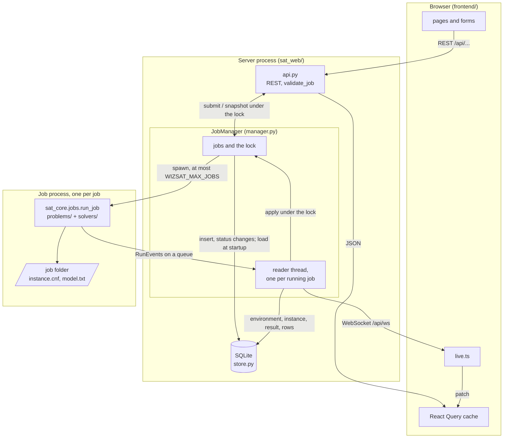
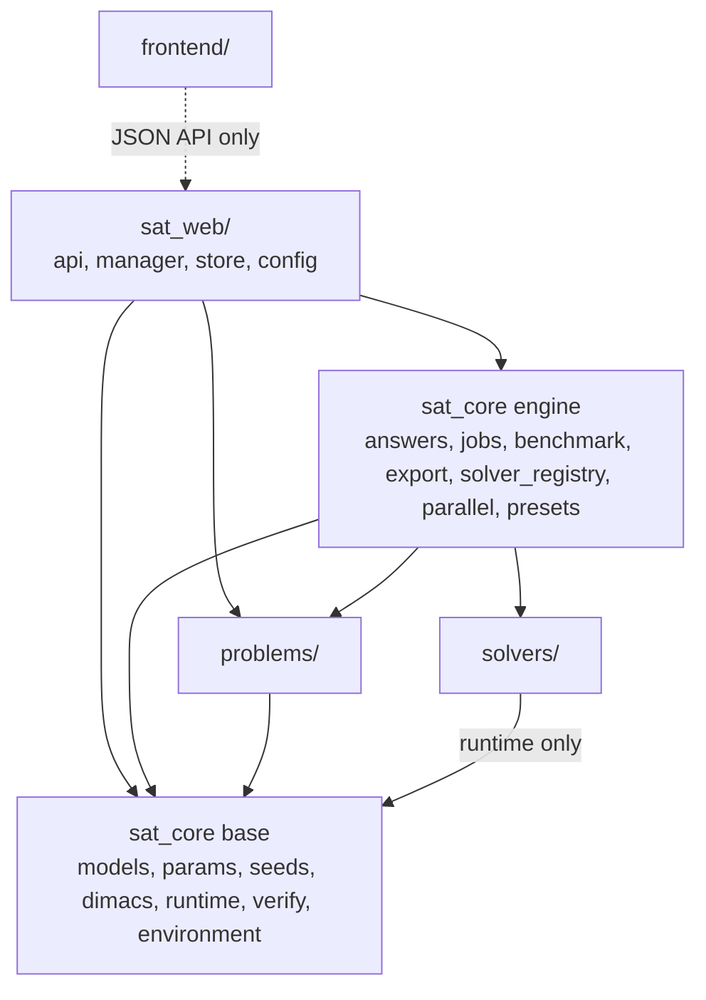
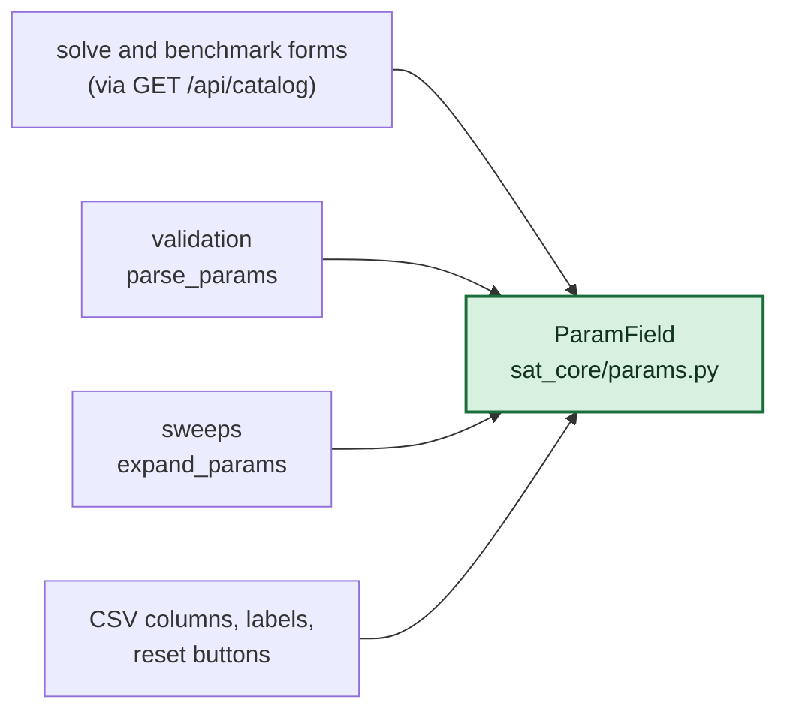
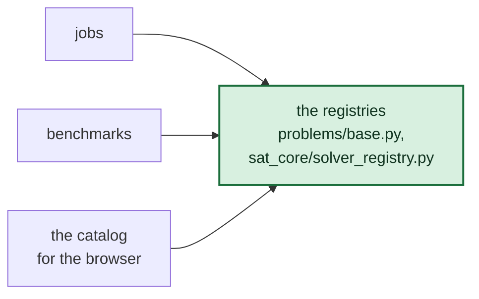
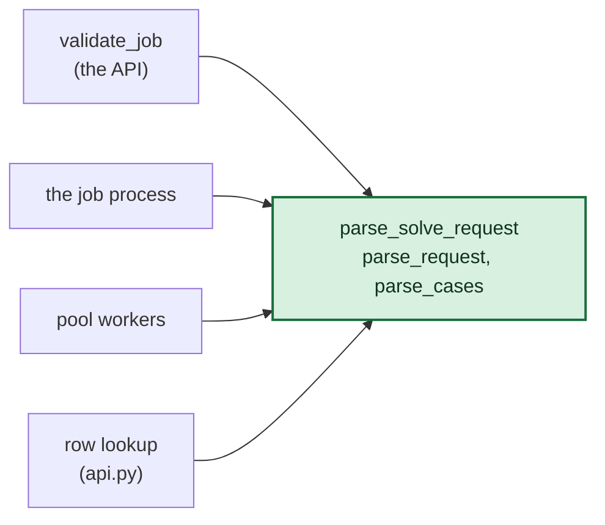
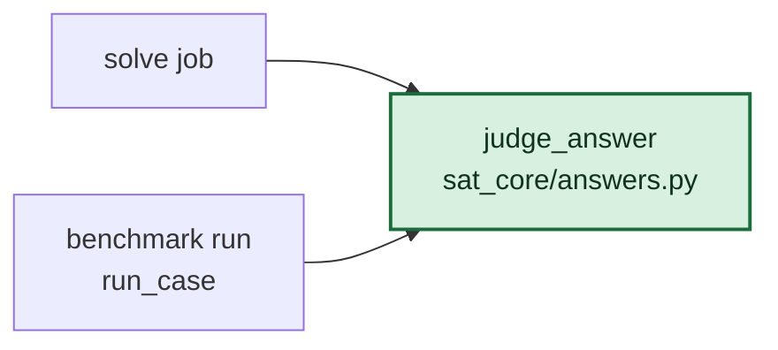
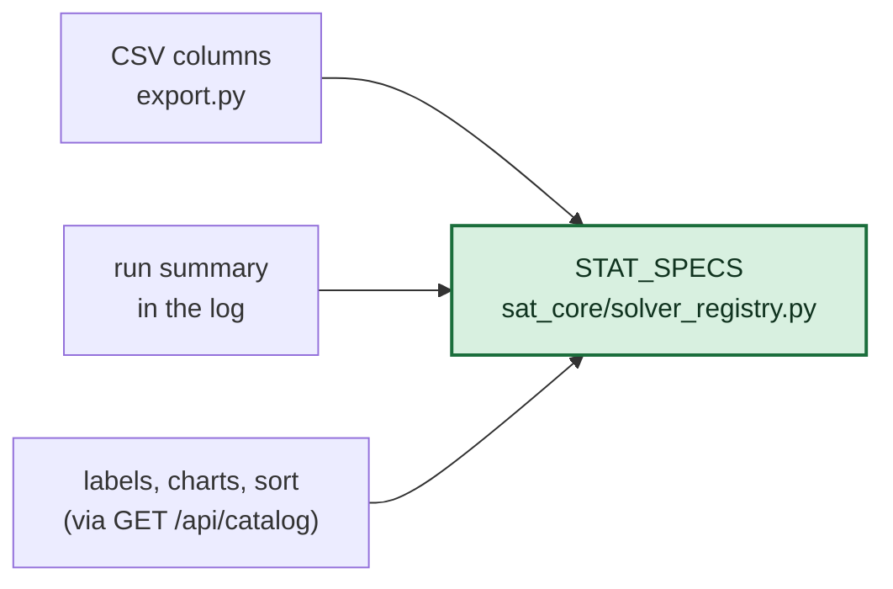
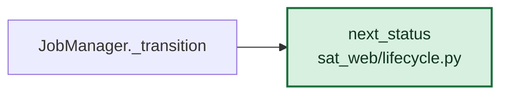
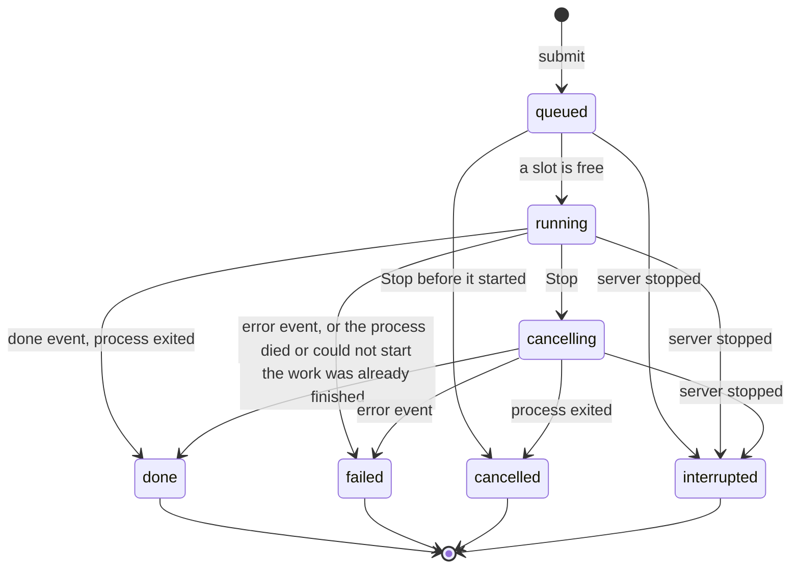
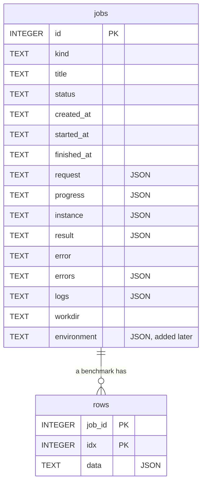

# Architecture

WizSAT is a Python backend with a React frontend, both running on the user's
machine. This page shows the parts, how they depend on each other, where each
rule lives, and what is stored. For the reasons behind each choice and a
step-by-step walk through one solve, read [How it works](how-it-works.md).
The file-by-file map is in [AGENTS.md](../../AGENTS.md); words with a fixed
meaning are in the [glossary](../../GLOSSARY.md).

## The big picture

Three separate programs run while the app is in use:

- **The browser** (`frontend/`): the React app the user sees.
- **The server process** (`sat_web/`): answers HTTP requests, keeps track of
  jobs and owns the database.
- **A job process, one per job**: every solve, encode or benchmark runs in
  its own Python process, so a slow solver cannot freeze the server and a job
  can be stopped.

An arrow here means "data travels this way". Start at "pages and forms" and
follow the arrows; they form two loops that end in the same cache.

- **Asking (REST):** a page sends a request to `api.py`, and the JSON reply
  goes into the React Query cache.
- **Being told (WebSocket):** the job process reports progress as events.
  The reader thread applies them, saves what must survive a restart, and
  pushes them to the browser, where `live.ts` patches the cache.

Pages read only the cache. The reader thread is part of the `JobManager`,
drawn apart because it runs on its own thread. The walk through one solve is
in [How it works](how-it-works.md#one-solve-start-to-finish).

## Layers

| Layer | Package | Knows about | Never touches |
|---|---|---|---|
| Solvers | `solvers/` | CNF clauses, options, cancellation token | problems, files, web |
| Problems | `problems/` | one NP problem: parameters, encoding, decoding, checks | web, solvers' internals |
| Core | `sat_core/` | parameter schema, solver registry, benchmarks, jobs, DIMACS | web, UI |
| Server | `sat_web/` | HTTP, WebSocket, processes, SQLite | encodings, solver internals |
| Frontend | `frontend/` | the JSON API | Python |

Who imports whom:

Here an arrow means "imports": A -> B means A depends on B. The dotted arrow
is the JSON API, the frontend's only link to the backend.

**Every arrow points down.** Code may import what is below it, never what is
above it, and `tests/test_layers.py` checks every import statement, the ones
inside functions too. `sat_core` is drawn as two boxes because as one box it
would be in a cycle with `problems/`. The base modules import nothing from
the other packages; the engine modules connect problems and solvers. A new
`sat_core` module is placed in one half in `tests/test_layers.py`.

## Where each rule lives

Each of these rules is written once, in the green box, and read by the
boxes that point at it. An arrow means "uses". To change the rule, change
the green box; nothing else holds a copy.

### Parameters

Every parameter of a problem or a solver is one `ParamField`. The frontend never declares a field of its own, so a new parameter is one line in Python. Details: [the parameter schema](how-it-works.md#the-parameter-schema).

### Problems and solvers

Code asks `get_problem(key)` or `get_solver(name)` and never branches on a name. A new problem is one file under `problems/`, imported in `problems/__init__.py`. Details: [registries](how-it-works.md#registries-instead-of-switch-statements).

### Requests

A solve request is parsed by `parse_solve_request` (`sat_core/jobs.py`) and a benchmark request by `parse_request` (`sat_core/benchmark.py`), on the server and again in the job process, with the same checks. `parse_cases` gives a benchmark's cases without its solvers.

### Is the answer right?

One rule decides `verified`: the model satisfies every clause, it decodes, and the problem's own check passes. A result without a model is not judged.

### Statistics

Each statistic a solver reports is one `StatSpec`: label, log name, explanation, CSV and chart flags. The frontend keeps no list of statistic keys.

### Job status

The manager assigns a job's status in one place, which asks this pure function. The diagram under [Statuses](#statuses) and `tests/test_lifecycle.py` are kept equal by that test.

## Statuses

The rule behind every arrow is `next_status` in `sat_web/lifecycle.py`. A
happening on a finished job changes nothing. To add a status or an arrow,
change the table in `tests/test_lifecycle.py`, this diagram and
`next_status` together; the test fails while one of them is behind. What
each arrow means, and how Stop, Skip and timeouts work, is in
[How it works](how-it-works.md#statuses).

## The database

`sat_web/store.py` keeps everything in one SQLite file, `output/wizsat.db`
(`WIZSAT_DATA_DIR` moves it). There are two tables:

**`jobs`**: one row per job, of every kind.

| Column | Holds |
|---|---|
| `id` | the job number, J7 is 7 |
| `kind`, `title`, `status` | `solve`, `generate` or `benchmark`; the name shown in the UI; one of the [statuses](#statuses) |
| `created_at`, `started_at`, `finished_at` | ISO times |
| `request` | the request after validation, with defaults and seeds filled in, so a rerun repeats the same job |
| `progress` | the last progress report: current step, total, message |
| `instance` | the encoded formula's summary: size, facts, the picture to draw (`InstanceSummary` in `sat_core/models.py`) |
| `result` | a solve job's outcome: status, time, statistics, decoded answer, `verified` (`SolveOutcome`) |
| `error`, `errors` | why a job failed, and the per-field messages of a request that was refused in the job |
| `logs` | the last 1000 log lines, written when the job ends |
| `workdir` | the job's folder, `output/jobs/<id>/` |
| `environment` | the machine and software the job ran on (`run_environment()` in `sat_core/environment.py`) |

**`rows`**: one row per benchmark run, keyed by the job and the row index.
`data` is the whole `BenchmarkRow` as JSON: case, parameters, solver, status,
time, formula size and statistics. The CSV export is built from these rows.

Large files are not in the database. Each job's folder holds `instance.cnf`
and `model.txt`, which can be downloaded or read in pieces.

The JSON columns are not split into SQL columns, so a new field in a result
or a row needs no migration. A new column on `jobs` is added with
`ALTER TABLE` when the store opens an older file (`ADDED_COLUMNS`). How the
store handles threads, the WAL files and startup is in
[How it works](how-it-works.md#persistence).

## Where to read more

| Question | Section of [How it works](how-it-works.md) |
|---|---|
| What happens, step by step, when I click Solve? | [One solve, start to finish](how-it-works.md#one-solve-start-to-finish) |
| Why processes and not threads? What is the GIL? | [Jobs](how-it-works.md#jobs) |
| What does the lock protect? | [Locks and threads](how-it-works.md#locks-and-threads) |
| How do parallel benchmarks keep the same rows? | [Parallel benchmark runs](how-it-works.md#parallel-benchmark-runs) |
| How do REST and WebSocket agree? | [Consistency between REST and WebSocket](how-it-works.md#consistency-between-rest-and-websocket) |
| How is the frontend put together? | [Frontend](how-it-works.md#frontend) |
| What does the server serve, and how is it protected? | [Serving](how-it-works.md#serving), [Limits and safety](how-it-works.md#limits-and-safety) |
| Endpoints, JSON and events | [API reference](api.md) |
