# Architecture

WizSAT is a Python backend with a React frontend, both running on the user's
machine. This page shows the parts, how they depend on each other, where each
rule lives, and what is stored. For the reasons behind each choice and a
step-by-step walk through one solve, read [How it works](how-it-works.md).
The file-by-file map is in [AGENTS.md](../../AGENTS.md); words with a fixed
meaning are in the [glossary](../../GLOSSARY.md).

## The big picture

Three separate programs run while the app is in use:

- **The browser** (`frontend/`): the React app the user sees.
- **The server process** (`sat_web/`): answers HTTP requests, keeps track of
  jobs and owns the database.
- **A job process, one per job**: every solve, encode or benchmark runs in
  its own Python process, so a slow solver cannot freeze the server and a job
  can be stopped.

How to read the diagram: a yellow band is a **process**, a separate running
program. A rounded box is work done on one of the server's **threads**. The
other shapes are things that hold data or carry a signal. An arrow means
"this travels this way", and the numbers mark the three paths.

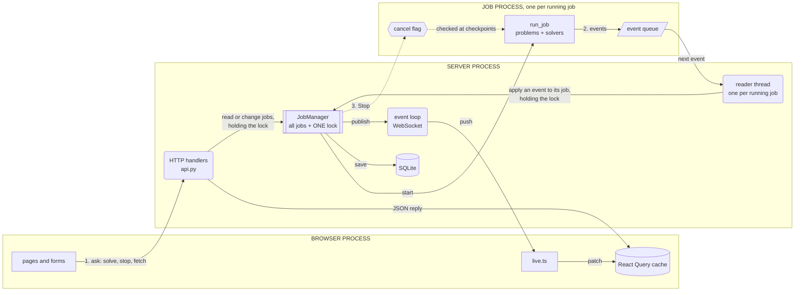

The boxes:

| Box | Shape | What it is |
|---|---|---|
| BROWSER, SERVER, JOB PROCESS | yellow band | a separate running program; the job band exists once per running job |
| pages and forms | rectangle | the React pages the user clicks |
| React Query cache | cylinder | the browser's copy of server data; pages read only this |
| live.ts | rectangle | the browser end of the WebSocket |
| HTTP handlers (`api.py`) | rounded | the code that answers each request. The job endpoints run on the event-loop thread; slow work (validation, reading rows, delete) is handed to a pool of worker threads |
| JobManager (`manager.py`) | double box | the server's list of all jobs, and the one lock that guards it |
| event loop | rounded | the server's main thread. It also runs the job endpoints; it is drawn here for the part it plays in path 2, writing messages to open browser tabs |
| reader thread | rounded | one per running job; takes that job's events and applies them |
| SQLite (`store.py`) | cylinder | the database file, `output/wizsat.db` |
| run_job (`sat_core/jobs.py`) | rectangle | the code that encodes and solves, inside the job process |
| event queue | parallelogram | the pipe from a job process to its reader thread |
| cancel flag | hexagon | a yes/no flag shared by the server and one job process |

The arrows:

| Path | Arrow | What travels |
|---|---|---|
| 1 | pages -> HTTP handlers | an HTTP request: create a job, Stop, fetch a job or its rows |
| 1 | HTTP handlers -> JobManager | the request reads or changes the jobs in the server's memory while holding the lock: a snapshot for a reply, a new job, a Stop, a delete. Starting a process or setting the cancel flag is a result of that change; the lock never reaches a process |
| 1 | HTTP handlers -> cache | the JSON reply |
| | JobManager -> run_job | "start": a new job process, when fewer than `WIZSAT_MAX_JOBS` run |
| 2 | run_job -> event queue | an event: environment (always first), log line, progress, plan, instance, result, row, then done, error or cancelled |
| 2 | event queue -> reader | the reader takes the next event; it waits while the queue is empty |
| 2 | reader -> JobManager | `_apply`: the reader updates its job while holding the same lock, so a request never sees the job half updated |
| 2 | JobManager -> SQLite | what must survive a restart is saved |
| 2 | JobManager -> event loop | the change is published |
| 2 | event loop -> live.ts | it is pushed over the WebSocket |
| 2 | live.ts -> cache | the cached job is patched, and the page re-renders |
| 3 | JobManager -> cancel flag | a Stop sets the flag (dotted: a signal, not data) |
| 3 | cancel flag -> run_job | the solver checks it at its checkpoints and stops |

Three things the diagram leaves out:

- **Several jobs at once** are several copies of the job band, each with its
  own queue and reader thread. All of them share the one `JobManager` and its
  lock.
- **A benchmark with `workers` above 1** starts a pool of worker processes
  inside its job process
  ([How it works](how-it-works.md#parallel-benchmark-runs)).
- **The skip flag**, a second flag next to the cancel flag, used by
  benchmarks for Skip case.
- **The job folder**, `output/jobs/<id>/`, where the job process writes
  `instance.cnf` and `model.txt`.
- **The solver child**, a process inside the job process (or inside a pool
  worker) that exists only when `WIZSAT_SOLVER_PYTHON` is set: each run then
  starts a child of that interpreter (PyPy), sends it the formula as JSON and
  reads back log lines and a result
  (`sat_core/solver_process.py`, [How it works](how-it-works.md#daemons-and-the-watchdog)).
  The events and the cancel flag work as drawn: the job process forwards the
  log lines and ends the child on Stop. Unset, nothing changes.

Pages read only the cache, whether a value came as a reply (path 1) or as an
event (path 2). The reader thread is code of the `JobManager` running on
its own thread. The lock is what lets the event loop, the pool threads and
the reader threads touch the same jobs safely. More in
[How it works](how-it-works.md): why the reader thread is needed
([What the big picture hides](how-it-works.md#what-the-big-picture-hides)),
every way the server can reach a running job
([Talking to a running job](how-it-works.md#talking-to-a-running-job)), when
the flags are read
([Stop, Skip and timeouts](how-it-works.md#stop-skip-and-timeouts)), and
which threads share the lock
([Locks and threads](how-it-works.md#locks-and-threads)). The walk through one
solve is in
[How it works](how-it-works.md#one-solve-start-to-finish).

## Layers

| Layer | Package | Knows about | Never touches |
|---|---|---|---|
| Solvers | `solvers/` | CNF clauses, options, cancellation token | problems, files, web |
| Problems | `problems/` | one NP problem: parameters, encoding, decoding, checks | web, solvers' internals |
| Core | `sat_core/` | parameter schema, solver registry, benchmarks, jobs, DIMACS | web, UI |
| Server | `sat_web/` | HTTP, WebSocket, processes, SQLite | encodings, solver internals |
| Frontend | `frontend/` | the JSON API | Python |

Who imports whom:

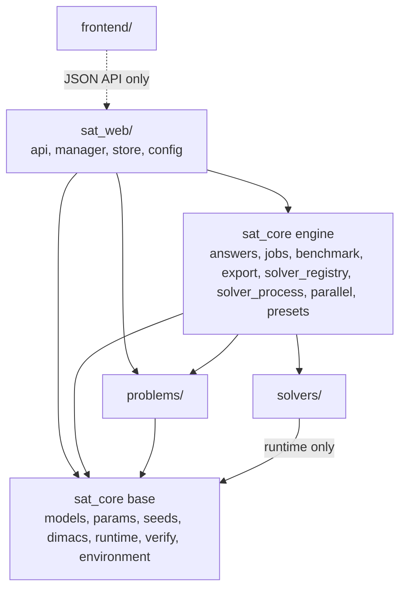

Here an arrow means "imports": A -> B means A depends on B. The dotted arrow
is the JSON API, the frontend's only link to the backend.

**Every arrow points down.** Code may import what is below it, never what is
above it, and `tests/test_layers.py` checks every import statement, the ones
inside functions too. `sat_core` is drawn as two boxes because as one box it
would be in a cycle with `problems/`. The base modules import nothing from
the other packages; the engine modules connect problems and solvers. A new
`sat_core` module is placed in one half in `tests/test_layers.py`.

## Where each rule lives

Each of these rules is written once, in the green box, and read by the
boxes that point at it. An arrow means "uses". To change the rule, change
the green box; nothing else holds a copy.

### Parameters

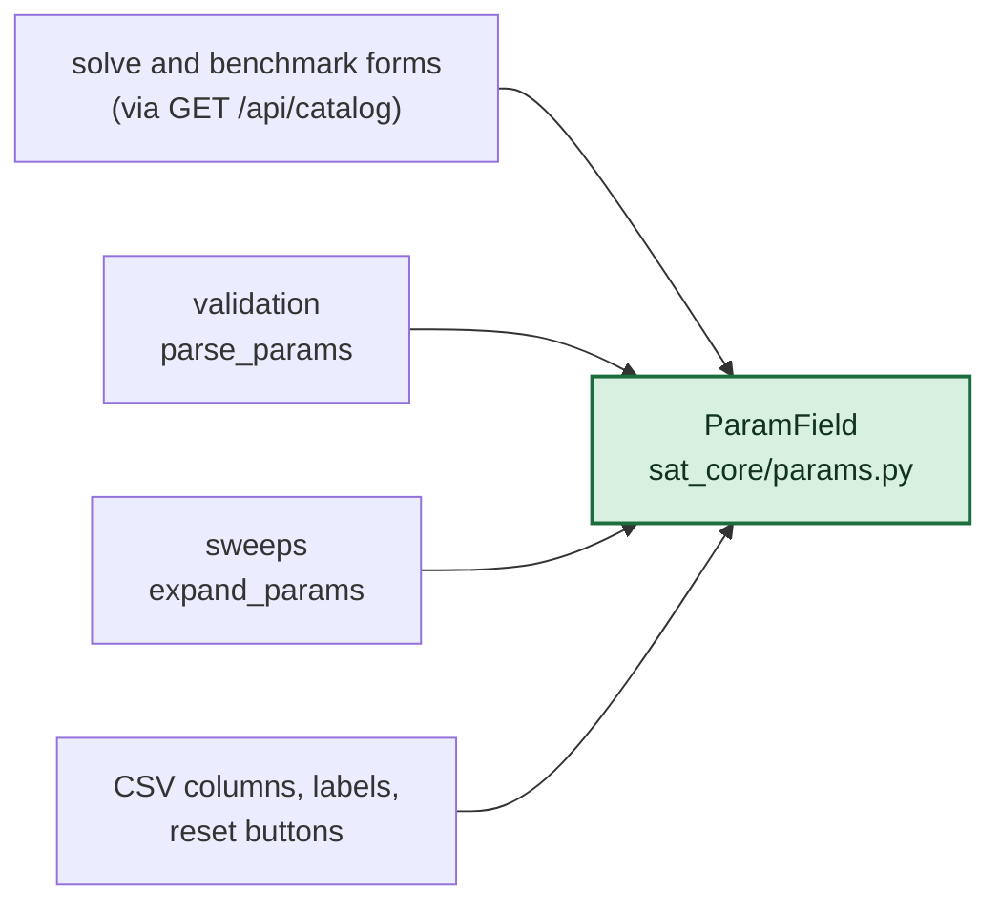

Every parameter of a problem or a solver is one `ParamField`. The frontend never declares a field of its own, so a new parameter is one line in Python. Details: [the parameter schema](how-it-works.md#the-parameter-schema).

### Problems and solvers

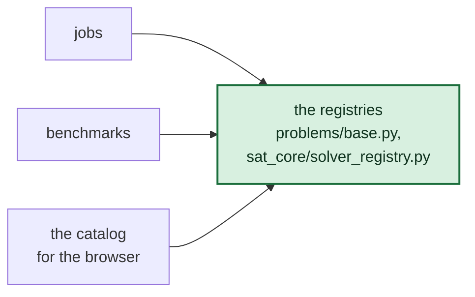

Code asks `get_problem(key)` or `get_solver(name)` and never branches on a name. A new problem is one file under `problems/`, imported in `problems/__init__.py`. Details: [registries](how-it-works.md#registries-instead-of-switch-statements).

### Where a solver runs

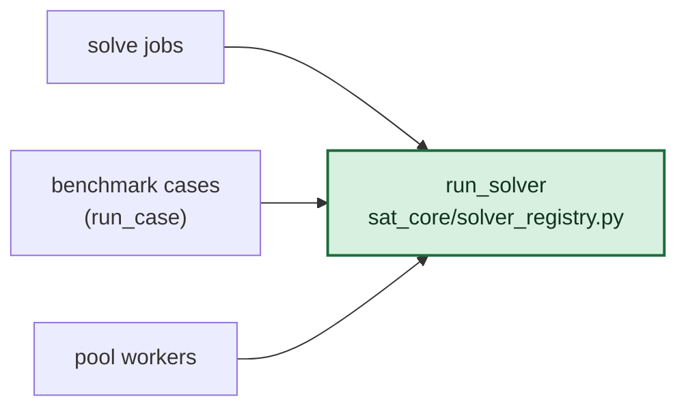

`run_solver` reads `WIZSAT_SOLVER_PYTHON`: unset, the solver runs in the
calling process; set, `run_in_child` (`sat_core/solver_process.py`) runs it in
a child of that interpreter. No other code asks which. The child's protocol is
in the docstring of `solver_process.py`, its lifetime in
[ADR 0006](../adr/0006-the-solver-child-ends-with-its-stdin.md), and the
interpreter a result records comes from one probe per job
(`interpreter_facts()` in `sat_core/environment.py`).

### Requests

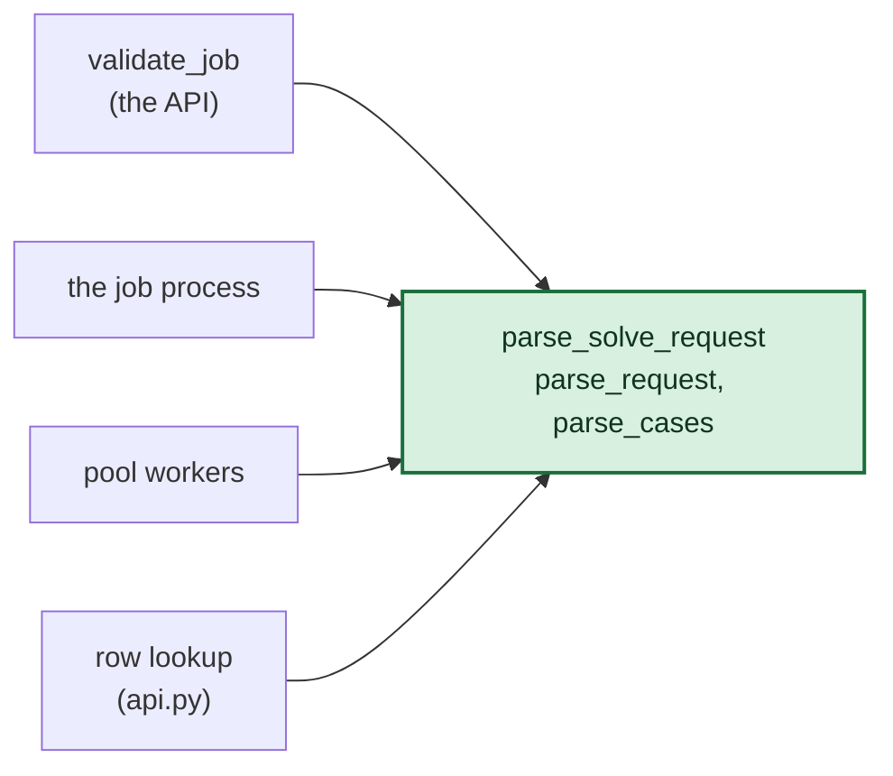

A solve request is parsed by `parse_solve_request` (`sat_core/jobs.py`) and a benchmark request by `parse_request` (`sat_core/benchmark.py`), on the server and again in the job process, with the same checks. `parse_cases` gives a benchmark's cases without its solvers.

### Is the answer right?

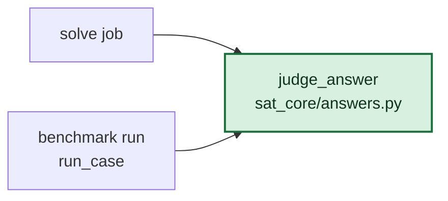

One rule decides `verified`: the model satisfies every clause, it decodes, and the problem's own check passes. A result without a model is not judged.

### Statistics

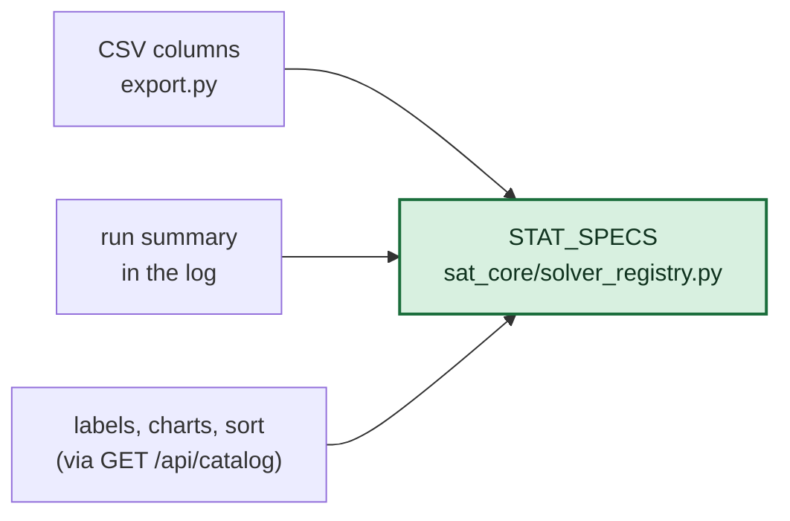

Each statistic a solver reports is one `StatSpec`: label, log name, explanation, CSV and chart flags. The frontend keeps no list of statistic keys.

### Job status

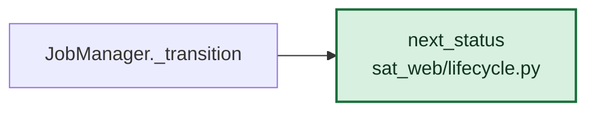

The manager assigns a job's status in one place, `JobManager._transition`, which asks this pure function. `tests/test_lifecycle.py` checks it arrow by arrow.

## Statuses

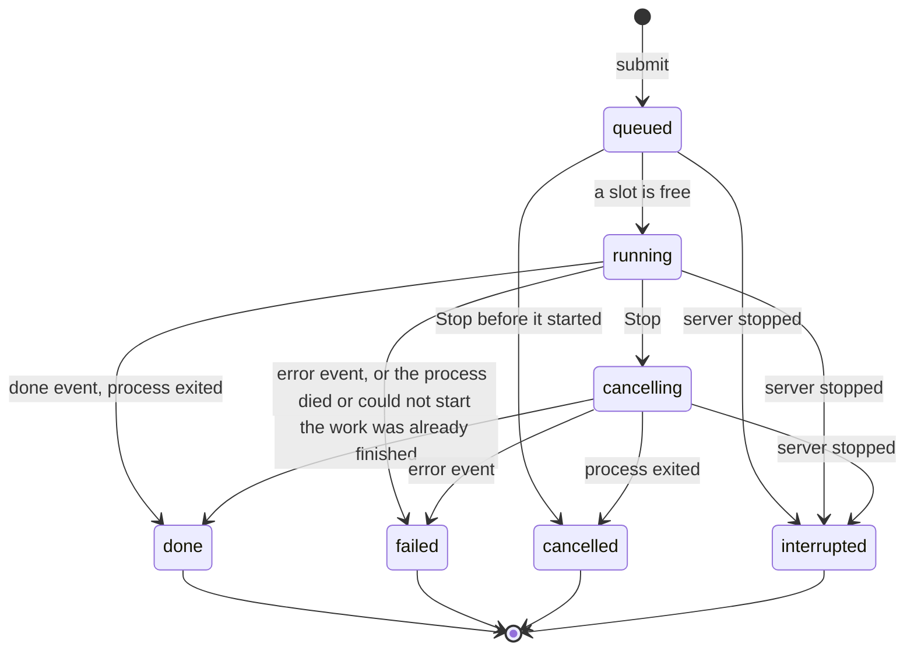

The rule behind every arrow is `next_status` in `sat_web/lifecycle.py`. A
happening on a finished job changes nothing. To add a status or an arrow,
change `next_status`, the table in `tests/test_lifecycle.py` and this
diagram together. The test checks the code against its table; nothing checks
the diagram, so keep it in step by hand. What each arrow means is in
[How it works](how-it-works.md#statuses), and how Stop, Skip and timeouts
reach a solver in
[Stop, Skip and timeouts](how-it-works.md#stop-skip-and-timeouts).

## The database

`sat_web/store.py` keeps everything in one SQLite file, `output/wizsat.db`
(`WIZSAT_DATA_DIR` moves it). There are two tables:

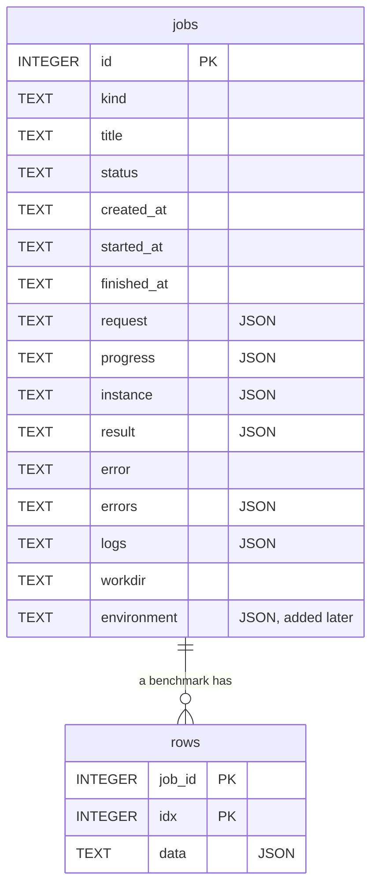

**`jobs`**: one row per job, of every kind.

| Column | Holds |
|---|---|
| `id` | the job number, J7 is 7 |
| `kind`, `title`, `status` | `solve`, `generate` or `benchmark`; the name shown in the UI; one of the [statuses](#statuses) |
| `created_at`, `started_at`, `finished_at` | ISO times |
| `request` | the request after validation, with defaults and seeds filled in, so a rerun repeats the same job |
| `progress` | the last progress report: current step, total, message |
| `instance` | the encoded formula's summary: size, facts, the picture to draw (`InstanceSummary` in `sat_core/models.py`) |
| `result` | a solve job's outcome: status, time, statistics, decoded answer, `verified` (`SolveOutcome`) |
| `error`, `errors` | why a job failed, and the per-field messages of a request that was refused in the job |
| `logs` | the last 1000 log lines, written when the job ends |
| `workdir` | the job's folder, `output/jobs/<id>/` |
| `environment` | the machine and software the job ran on (`run_environment()` in `sat_core/environment.py`) |

**`rows`**: one row per benchmark run, keyed by the job and the row index.
`data` is the whole `BenchmarkRow` as JSON: case, parameters, solver, status,
time, formula size and statistics. The CSV export is built from these rows.

Large files are not in the database. Each job's folder holds `instance.cnf`
and `model.txt`, which can be downloaded or read in pieces.

The JSON columns are not split into SQL columns, so a new field in a result
or a row needs no migration. A new column on `jobs` is added with
`ALTER TABLE` when the store opens an older file (`ADDED_COLUMNS`). How the
store handles threads, the WAL files and startup is in
[How it works](how-it-works.md#persistence).

## Where to read more

| Question | Section of [How it works](how-it-works.md) |
|---|---|
| What happens, step by step, when I click Solve? | [One solve, start to finish](how-it-works.md#one-solve-start-to-finish) |
| Why processes and not threads? What is the GIL? | [Jobs](how-it-works.md#jobs) |
| What does the lock protect? | [Locks and threads](how-it-works.md#locks-and-threads) |
| Why is there a reader thread? | [What the big picture hides](how-it-works.md#what-the-big-picture-hides) |
| How can the server reach a running job? | [Talking to a running job](how-it-works.md#talking-to-a-running-job) |
| When does a solver notice Stop, Skip or a timeout? | [Stop, Skip and timeouts](how-it-works.md#stop-skip-and-timeouts) |
| How do jobs end when the server crashes? | [Daemons and the watchdog](how-it-works.md#daemons-and-the-watchdog) |
| How do parallel benchmarks keep the same rows? | [Parallel benchmark runs](how-it-works.md#parallel-benchmark-runs) |
| How do REST and WebSocket agree? | [Consistency between REST and WebSocket](how-it-works.md#consistency-between-rest-and-websocket) |
| How is the frontend put together? | [Frontend](how-it-works.md#frontend) |
| What does the server serve, and how is it protected? | [Serving](how-it-works.md#serving), [Limits and safety](how-it-works.md#limits-and-safety) |
| Endpoints, JSON and events | [API reference](api.md) |
