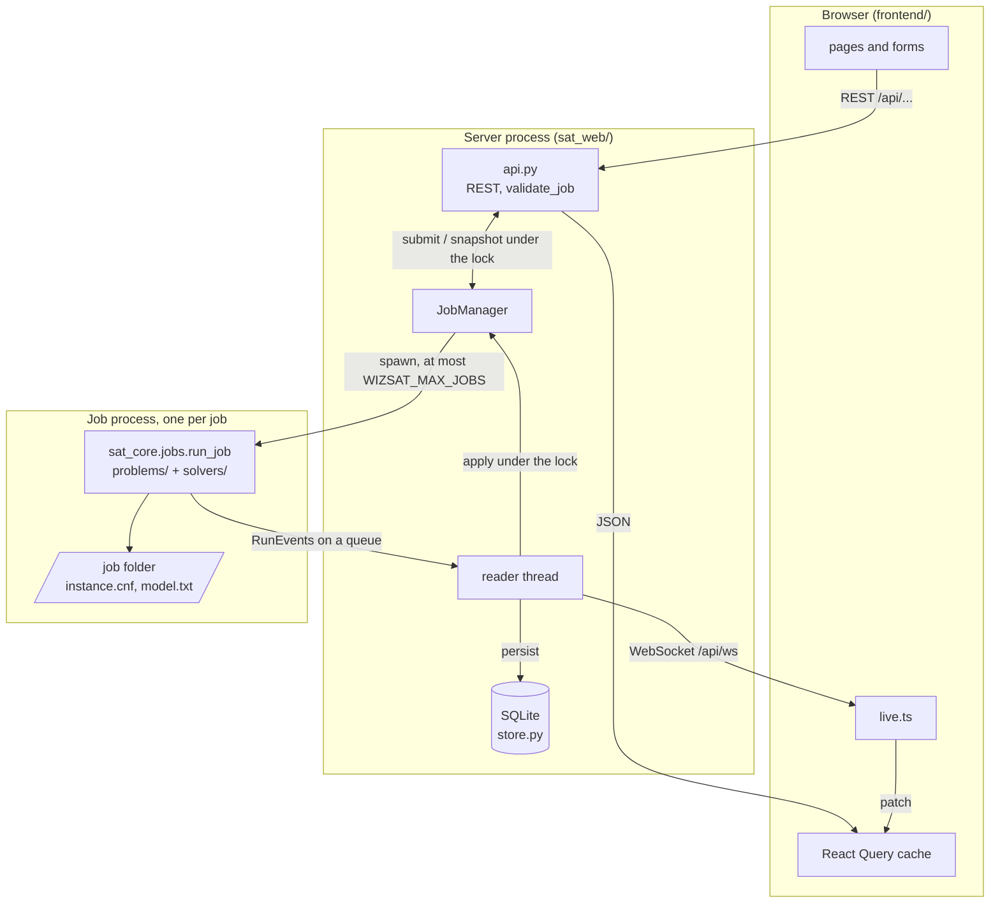
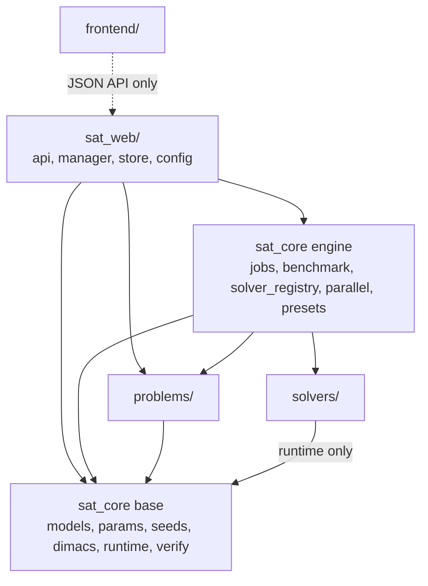
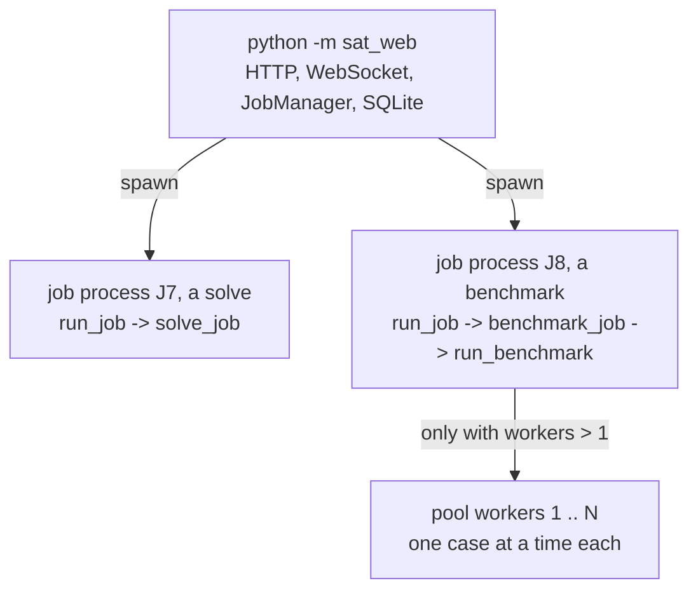
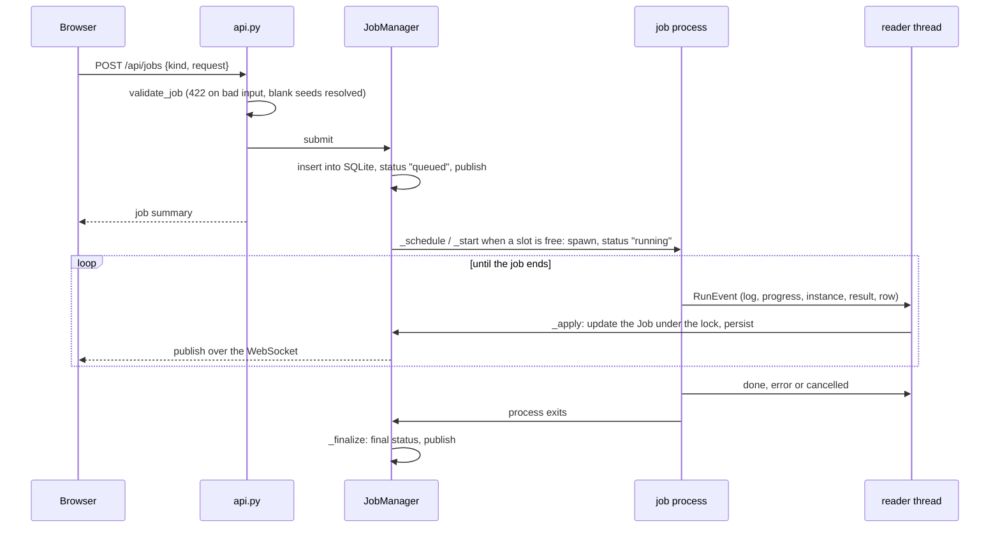
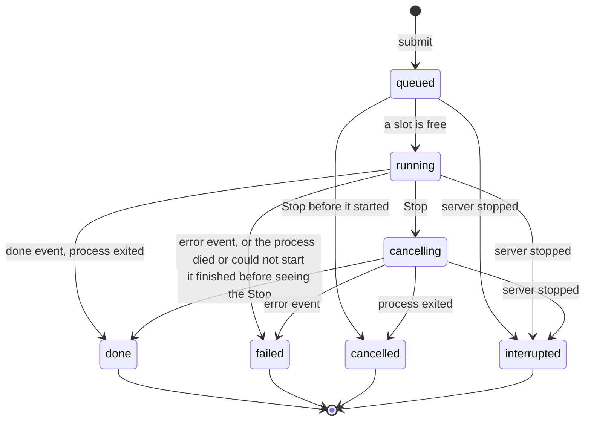
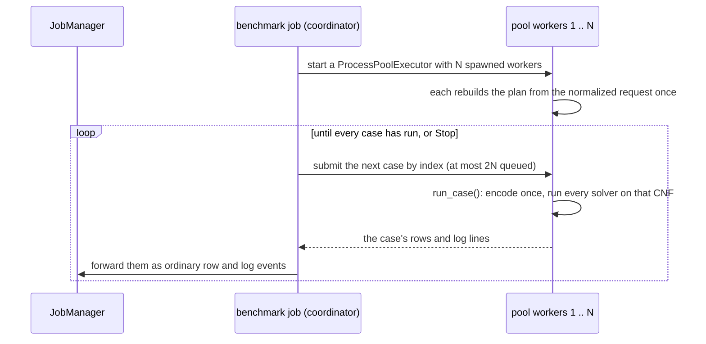
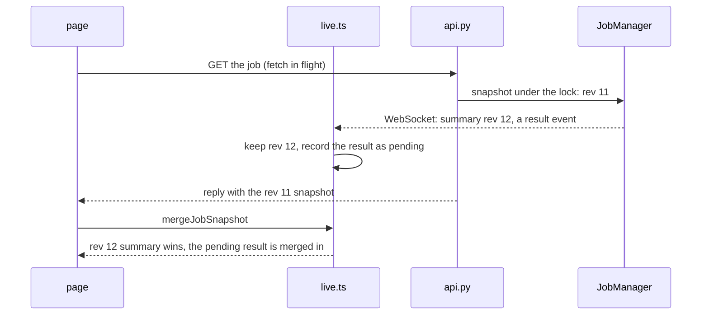

# Architecture

WizSAT is a Python backend with a React frontend, both running on the user's
machine. This page explains how the parts fit together and why they are
split the way they are. The file-by-file map is in [AGENTS.md](../../AGENTS.md).

## Layers

| Layer | Package | Knows about | Never touches |
|---|---|---|---|
| Solvers | `solvers/` | CNF clauses, options, cancellation token | problems, files, web |
| Problems | `problems/` | one NP problem: parameters, encoding, decoding, checks | web, solvers' internals |
| Core | `sat_core/` | parameter schema, solver registry, benchmarks, jobs, DIMACS | web, UI |
| Server | `sat_web/` | HTTP, WebSocket, processes, SQLite | encodings, solver internals |
| Frontend | `frontend/` | the JSON API | Python |

Who imports whom, module by module:

Every arrow points down. `sat_core` has two halves: its base modules import
nothing from the other packages, and problems build on them (`ParamField`,
`ProblemInstance`, seeds, DIMACS); its engine modules sit above problems and
solvers and connect them. Solvers use nothing but `sat_core.runtime`, for
events and cancellation. A command-line script or a notebook can use
`problems` and `sat_core` directly, without the server.

## Registries instead of switch statements

Problems and solvers are **registered**, and everything else is generated
from the registrations:

- `problems/base.py` keeps a registry of `ProblemSpec` objects
  (`@register_problem`). A spec declares its parameters as `ParamField`s and
  implements `encode`, `decode`, `check`, `estimate`, `describe`, `visual`
  and `preview`.
- `sat_core/solver_registry.py` keeps `SolverSpec` objects: a key, whether
  the solver is complete, typed option fields, and a runner function.

`GET /api/catalog` sends both registries to the browser. The frontend builds
forms, the benchmark builder, CSV columns and labels from the field
declarations, so adding a problem or solver option needs no frontend change
unless the answer needs a new kind of drawing. See
[Adding a problem or solver](adding-a-problem.md).

## The parameter schema

`sat_core/params.py` is shared by solve forms, solver options and
benchmarks:

- `parse_params(fields, raw)` coerces raw JSON values to the declared kinds,
  applies defaults and ranges, and raises one `ParamError` that collects
  every field error (invalid values are replaced by the default while
  checking, so later cross-field checks still run).
- `expand_params(fields, raw, allow_sweep=True)` turns lists and range strings
  into the cartesian product of cases, respecting `show_if` so dependent
  fields only multiply the cases where they apply.
- Field visibility (`show_if`) also decides which parameters are stored with a
  job, shown in labels and exported.

## Jobs

Everything that can take more than a moment runs as a **job** in its own
process:

| Kind | Body (`sat_core/jobs.py`) | Produces |
|---|---|---|
| `generate` | build the instance | instance event, `instance.cnf` |
| `solve` | build, run the solver, decode, verify | instance and result events, `instance.cnf`, `model.txt` |
| `benchmark` | expand the plan, run every case with every solver | one row event per run |

Why processes and not threads: the solvers are pure Python and CPU-bound, so
threads would share one core through the GIL, and a runaway solver could not
be stopped. Each job gets a `spawn`ed process, which also isolates crashes
(a worker that dies is reported as a failed job).

The processes while the app is busy:

Job processes are not daemons, because a benchmark job may start a pool of
its own (daemon processes may not have children). They still end with the
server: `JobManager.shutdown()` stops them, and every job and pool worker
runs a small watchdog thread (`exit_when_parent_dies` in
`sat_core/parallel.py`) that exits the process if its parent disappears, so
nothing keeps running after a crash.

### Lifecycle

One job, from the request to the end of its process:

The status a job can have, and what moves it on (`sat_web/manager.py`):

Jobs still `queued`, `running` or `cancelling` when the server starts again
are marked `interrupted`.

**Cancellation** is cooperative first: the manager sets a
`multiprocessing.Event`, the worker's `RunToken` sees it, and the solver
returns `CANCELLED` at its next check. If the process has not ended three
seconds later it is terminated. **Skip** (benchmarks) sets a second event
that ends only the current run with `SKIPPED`. **Timeouts** are the same
token with a deadline. Solvers ask the token every 2,048 steps, which keeps
the check cheap and the reaction time well under a second.

### Parallel benchmark runs

With `"workers": N` (N > 1) the benchmark job becomes a coordinator
(`sat_core/parallel.py`):

- `parse_request` is deterministic, so every process agrees on the cases.
- At most 2N cases wait in the queue, so a Stop does not leave a long queue
  behind.
- `run_case()` is the same function the sequential loop uses.
- Row indices are `case index x number of solvers + solver position`, so the
  rows equal those of a sequential run whatever order cases finish in.

Stop and Skip reach the workers through shared objects that a small thread
in the coordinator keeps in sync with the job's token: Stop sets a shared
event; Skip increments a shared counter. A worker remembers the counter when
it starts a case, and a changed counter means "skip this case". So Skip
affects exactly the cases running when it is pressed, never later ones.

### Persistence

`sat_web/store.py` keeps jobs and benchmark rows in SQLite
(`output/wizsat.db`, WAL mode), one shared connection behind a lock. Stored
per job: the normalized request, the instance summary, the result, the last
1000 log lines and every benchmark row. Large artifacts (the CNF, the model)
are files in `output/jobs/<id>/`. On startup, jobs that were running are
marked `interrupted`.

## Live updates

The worker never talks to the browser. Events flow:

1. the worker puts `RunEvent`s on its queue;
2. the manager's reader thread applies each event to the in-memory `Job`
   (under `JobManager.lock`), writes to SQLite, and hands a message to the
   asyncio loop with `call_soon_threadsafe`;
3. each WebSocket subscriber has a bounded queue; the socket sends batches of
   up to 500 messages. A client that falls too far behind gets `resync`.

Throttling keeps a chatty solver from flooding the browser: progress changes
only mark the job dirty and a flusher publishes dirty summaries every 0.2 s;
log lines are capped at 60 per second per job (the rest are counted and kept
in the job's log).

### Consistency between REST and WebSocket

A page usually fetches a job over HTTP while events for it stream in, so the
two can race: the HTTP reply may describe an older state than an event that
already arrived:

Two mechanisms make the result correct regardless of order:

- **`rev`**: every published job summary carries a revision number that the
  manager increments under its lock. HTTP snapshots are also taken under the
  lock. The client keeps whichever copy has the higher `rev`.
- **Pending merge**: while a fetch of a job or its rows is in flight,
  `frontend/src/api/live.ts` also records incoming `instance`, `result` and
  `row` events for that job and merges them into the reply when it arrives.
  Rows are merged by index, so duplicates are harmless.

## Frontend

- **Data**: TanStack Query caches server data (`["catalog"]`, `["job", id]`,
  `["rows", id]`). `live.ts` patches those caches from WebSocket events and
  keeps job summaries and streamed logs in a small zustand store.
- **Forms**: `components/fields/ParamForm.tsx` renders any field list, and
  the same values feed `POST /api/problems/{key}/preview` (debounced) for the
  live preview and size estimate. Inside a `CompactHelp` provider (the Solve
  page) it shows help as tooltips and puts short numeric fields two per row.
- **Defaults and settings**: `lib/params.ts` compares values with field
  defaults (`isDefaultValue`, `changedFields`) and prints them readably
  (`displayValue`). `ParamForm` uses them for the reset buttons;
  `components/SolverSettingsTable.tsx` for the Settings tab of a solve job,
  the Setup tab of a benchmark (`components/BenchmarkSetup.tsx`) and the run
  drawer. Statistics get their labels and explanations from `STATS` in
  `lib/format.ts`.
- **Answers**: `components/views/ProblemViews.tsx` picks a renderer by the
  problem's `result_view`: Sudoku board, chessboard, graph (Cytoscape) or
  assignment grid.
- **Benchmarks**: `lib/benchmark.ts` converts between the builder's draft and
  the benchmark request; `lib/stats.ts` aggregates rows for the charts
  (ECharts) and tables.
- **Routing**: `/solve/:problem`, `/benchmarks`, `/benchmarks/new`,
  `/benchmarks/:id`, `/jobs`, `/jobs/:id` (a solve or encode job on its own
  page; benchmarks redirect to their results page), `/learn/:topic`. The Python server returns
  `index.html` for any non-API path, so deep links work.
- **Tests**: vitest runs in jsdom. Pure helpers are tested directly
  (`lib/lib.test.ts`); a component test renders through `renderWithApp()`
  (`test/render.tsx`), which supplies the Mantine theme and a fresh React
  Query client; `test/fields.ts` builds parameter fields for fixtures. `test/setup.ts` adds the browser APIs jsdom lacks
  (`matchMedia`, `ResizeObserver`) and unmounts after each test.

## Serving

`python -m sat_web` (`sat_web/__main__.py`) rebuilds the frontend when
sources are newer than `frontend/dist`, picks a free port, opens the browser
and runs Uvicorn with the app factory `sat_web.api:create_app`. The app
serves:

| Path | Content |
|---|---|
| `/api/...` | REST endpoints and the WebSocket |
| `/assets/...` | the built frontend bundle |
| `/media/...` | `assets/` (logo, problem pictures) |
| `/visualisations/...` | `docs/visualisations/` (the standalone HTML visualisers) |
| anything else | `index.html` (client-side routes) |

In development, `npm run dev` serves the frontend with hot reload and
proxies `/api`, `/media` and `/visualisations` to the Python server.

## Limits and safety

- The server binds to `127.0.0.1`. There is no authentication because
  nothing is exposed to the network.
- A page on another website can still make the user's browser send requests
  to `127.0.0.1`, so the middleware `LocalOnlyGuard` (`sat_web/api.py`) makes
  two checks in front of every route, static files and the WebSocket
  included. It answers 400 when the `Host` header is not an allowed name,
  which stops DNS rebinding (a hostile name that resolves to 127.0.0.1). It
  answers 403 when an `Origin` header names a host that is not allowed;
  requests without `Origin` (curl, scripts, same-origin page loads) pass.
  The allowed names are `Settings.allowed_hosts`: `localhost`, `127.0.0.1`
  and `[::1]`, plus the names in `WIZSAT_ALLOWED_HOSTS`, compared exactly
  (lower case, any port). The launcher adds its `--host` value to that
  variable, and a value that is not a plain name or address stops the start.
  The reasons are in [ADR 0002](../adr/0002-origin-and-host-checks.md).
  Not covered yet: another site can still show the app in a frame (audit
  item A13).
- `MAX_CLAUSES` (2,000,000, `WIZSAT_MAX_CLAUSES`) refuses instances whose
  estimated size would exhaust memory, before any encoding starts.
- `MAX_BENCHMARK_RUNS` (200,000) and `MAX_CASES` bound benchmark plans.
- Downloads are restricted to `instance.cnf` and `model.txt` inside a job's
  own folder; static files are served only from their directories.
