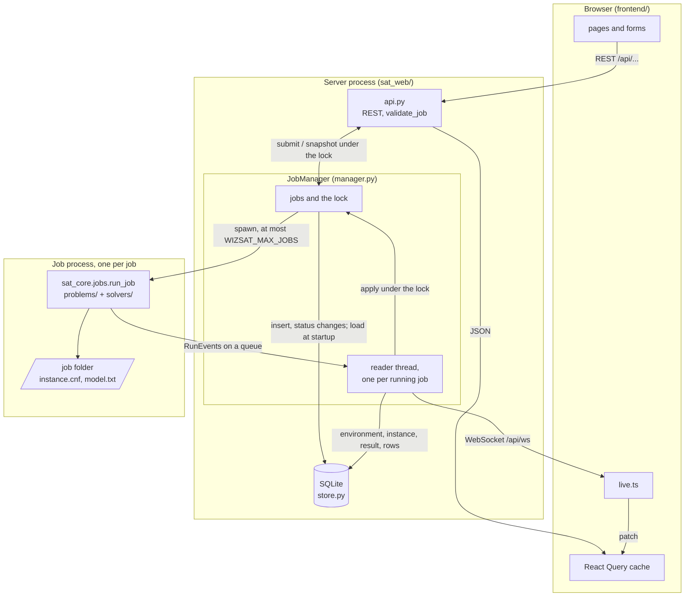
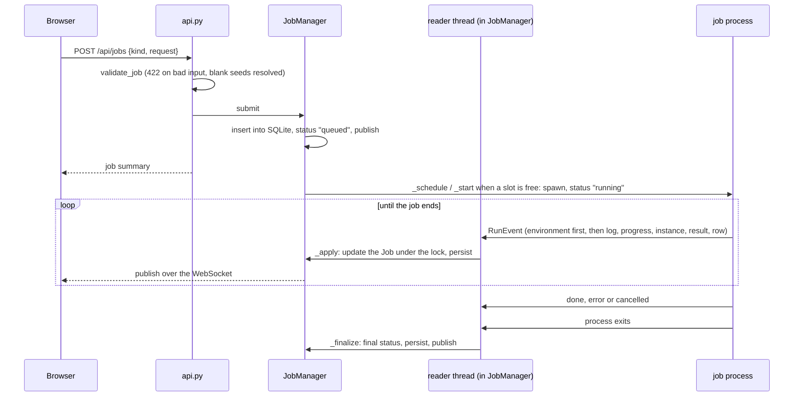
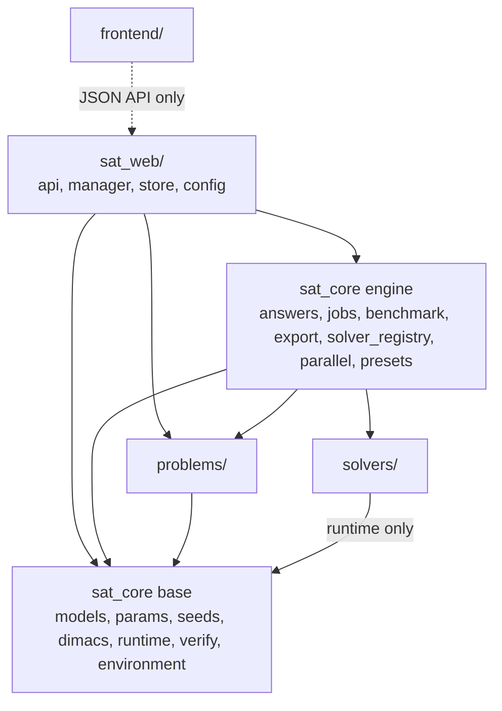
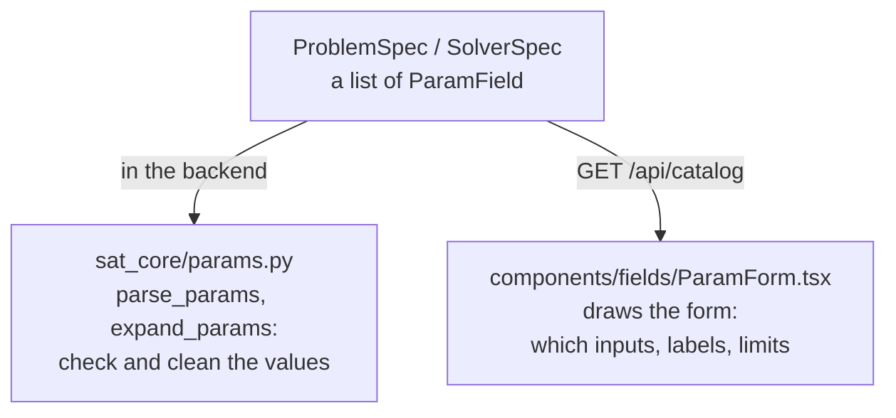
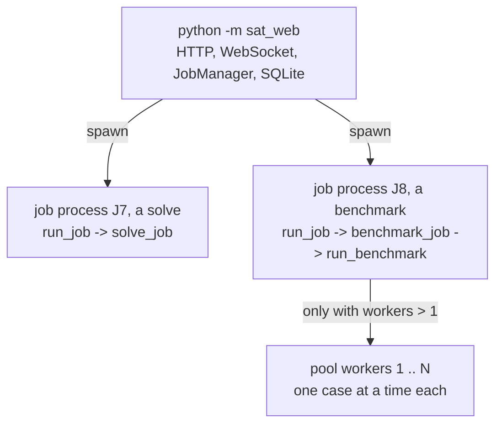
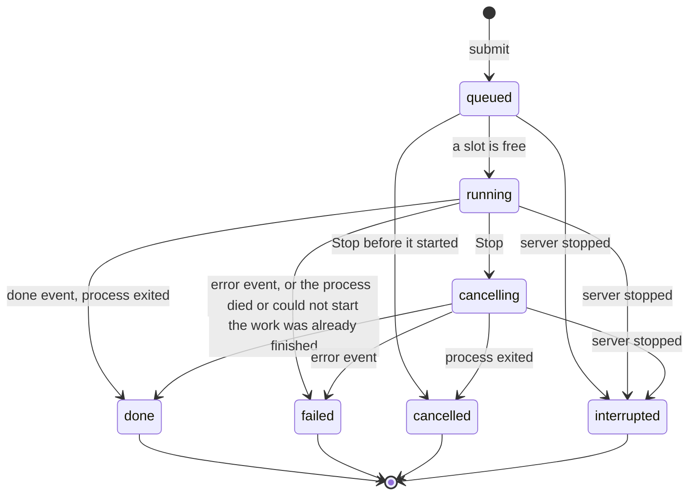
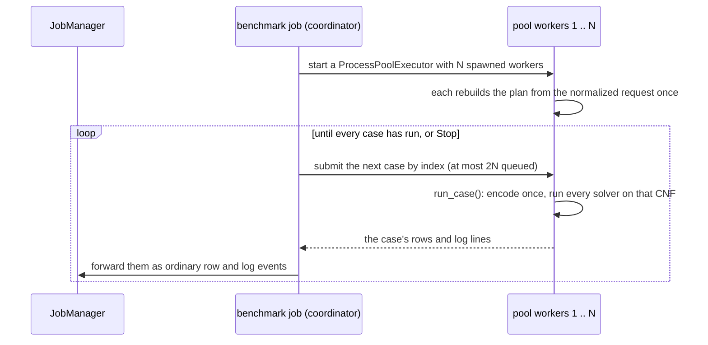
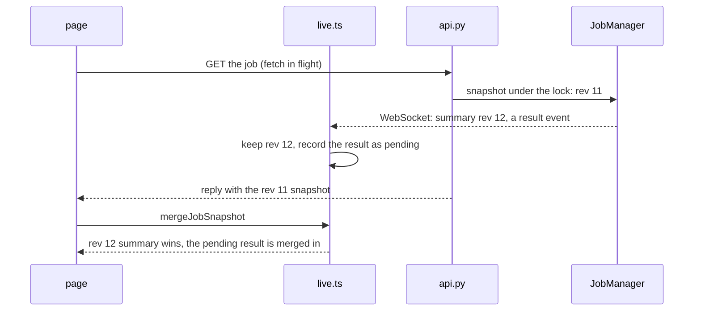

# Architecture

WizSAT is a Python backend with a React frontend, both running on the user's
machine. This page explains how the parts fit together and why they are
split the way they are. The file-by-file map is in [AGENTS.md](../../AGENTS.md);
the words with a fixed meaning (case, run, row, registry, ...) are in the
[glossary](../../GLOSSARY.md).

How to read this page: the first two sections are the story. "The big
picture" names the parts, and "One solve, start to finish" follows one click
through all of them. Everything after that is reference: each section
explains one part and can be read on its own.

## The big picture

Three separate programs run while the app is in use:

- **The browser** (`frontend/`): the React app the user sees.
- **The server process** (`sat_web/`): one Python process that stays
  running. It answers HTTP requests, keeps track of jobs and owns the
  database.
- **A job process, one per job**: every solve, encode or benchmark runs in
  its own Python process, so a slow or crashing solver cannot freeze the
  server and a job can be stopped cleanly.



An arrow in this diagram means "data travels this way". Start at "pages and
forms" and follow the arrows; they form two loops that end in the same place.

- **Asking (REST).** A page sends a request to `api.py`, and the JSON reply
  is stored in the React Query cache. Creating a job goes this way: `api.py`
  validates the request and hands it to the `JobManager`, which starts a job
  process when a slot is free.
- **Being told (WebSocket).** The job process reports its progress as
  events on a queue. A reader thread in the server takes them off the queue,
  updates the job, saves what must survive a restart, and pushes the event
  to the browser over a WebSocket. There, `live.ts` patches the same cache.

Pages never talk to the server directly: they read the cache, and they
re-render when it changes. Whether a value arrived as a reply or as an event
makes no difference to them.

Two details the boxes hide:

- The **reader thread is part of the `JobManager`**, not a separate
  component. It is the method `JobManager._reader()` running on its own
  thread, one thread per running job. The diagrams on this page draw threads
  and processes, not classes, so the manager appears twice wherever its code
  runs on two threads.
- **Both halves of the manager write to SQLite.** The request side inserts
  the job (that is how it gets its number) and saves status changes; the
  reader side saves the instance summary, the result and benchmark rows as
  they arrive. At startup the manager loads the saved jobs back.

## One solve, start to finish

What happens when the user opens `/solve/sudoku` and clicks **Solve**.

**Before the click.** When the app loads, `main.tsx` calls
`startLiveConnection()` (`api/live.ts`), which opens the WebSocket
`/api/ws`. The server answers with a `hello` message that lists every job.
The live channel is open before any job exists and stays open.



**Phase 1: the click (REST).**

1. `SolvePage.tsx` builds the request (problem, parameters, solver, options,
   timeout) and `useCreateJob()` (`api/queries.ts`) sends `POST /api/jobs`.
2. `create_job()` in `sat_web/api.py` runs `validate_job()`, which calls
   `parse_solve_request()` in `sat_core/jobs.py` (the one parser of a solve
   request: problem, solver, options, timeout, log level). A bad value is
   refused here with a 422 that names the field, which is where the red
   messages under the form come from. `solve_job()` calls the same parser
   when the job runs, so a script that runs a job without the API is refused
   the same things.
3. `JobManager.submit()` inserts the job into SQLite with status `queued`,
   creates the in-memory `Job`, publishes it, and calls `_schedule()`.
4. If fewer than `WIZSAT_MAX_JOBS` jobs are running, `_start()` creates the
   job folder and a queue, spawns the job process, sets the status to
   `running`, and starts the reader thread that waits on the queue.
5. The HTTP reply carries the job summary. The page puts `?job=7` in the
   URL, and `SolveResultPanel.tsx` calls `useJob(7)`, which fetches
   `GET /api/jobs/7` once and caches it under `["job", 7]`.

After this the page never asks again while the job runs.

**Phase 2: the solver works (WebSocket).**

6. In the job process, `run_job()` calls `solve_job()`
   (`sat_core/jobs.py`). It encodes the Sudoku, writes `instance.cnf`, runs
   the solver, writes `model.txt`, and puts events on the queue as it goes:
   log lines, progress, the instance summary, the result, and finally
   `done`.
7. The reader thread passes each event to `_apply()`, which updates the
   `Job` under the lock. The instance summary and the result are saved to
   SQLite and published at once; progress is throttled (see
   [Live updates](#live-updates)).
8. `applyEvents()` in `live.ts` patches `["job", 7]` for each event. The
   panel re-renders every time: the progress text changes, the instance size
   appears, the badge turns to **done**, and the solved board is drawn.

**Phase 3: the end.** The process exits. The reader thread notices, drains
what is left in the queue and calls `_finalize()`, which records the final
status and the end time, saves the log tail, and publishes once more. Then
`_schedule()` runs again, so a waiting job can take the free slot.

One subtle point: in step 5 the fetch of job 7 is in flight while events for
job 7 may already be arriving. How the two are reconciled is explained under
[Consistency between REST and WebSocket](#consistency-between-rest-and-websocket).

## Layers

| Layer | Package | Knows about | Never touches |
|---|---|---|---|
| Solvers | `solvers/` | CNF clauses, options, cancellation token | problems, files, web |
| Problems | `problems/` | one NP problem: parameters, encoding, decoding, checks | web, solvers' internals |
| Core | `sat_core/` | parameter schema, solver registry, benchmarks, jobs, DIMACS | web, UI |
| Server | `sat_web/` | HTTP, WebSocket, processes, SQLite | encodings, solver internals |
| Frontend | `frontend/` | the JSON API | Python |

Who imports whom, module by module:



The arrows here mean something different from the first diagram: an arrow
from A to B means "A imports B", that is, A depends on B. Nothing travels
along these arrows at run time. The dotted arrow is the exception: the
frontend cannot import Python, so its only link to the backend is the JSON
API.

Every arrow points down: code may import what is below it, never what is
above it. `tests/test_layers.py` checks every import statement against this
diagram, the ones inside functions included, and a new `sat_core` module has
to be placed in one of the two halves there.

`sat_core` is one folder drawn as two boxes, because as one box the rule
could not hold. Problems need things from `sat_core` (`ParamField`,
`ProblemInstance`, seeds, DIMACS), and `sat_core` needs problems (`jobs.py`
looks up "sudoku" and encodes it). That would be a cycle. The split removes
it: the **base** modules import nothing from the other packages, and
problems build on them; the **engine** modules sit above problems and
solvers and connect them.

What the rule buys:

- A solver can be tested with a hand-written CNF and nothing else. It uses
  only `sat_core.runtime`, for events and cancellation.
- A problem does not know which solver will run it.
- A command-line script or a notebook can use `problems` and `sat_core`
  directly, without the server.

Inside the engine, `benchmark.py` and `parallel.py` use each other (the pool
workers call `run_case()` from `benchmark.py`). Those imports are written
inside functions so that neither module needs the other while it loads.

## Registries instead of switch statements

A **registry** is a dictionary from a key to an object that describes one
thing completely. There are two:

- `problems/base.py` keeps a registry of `ProblemSpec` objects, filled by
  the decorator `@register_problem`. A spec declares its parameters as
  `ParamField`s and implements `encode`, `decode`, `check`, `estimate`,
  `describe`, `visual` and `preview`.
- `sat_core/solver_registry.py` keeps `SolverSpec` objects: a key, whether
  the solver is complete, typed option fields, and a runner function.

The rest of the code never names a problem or a solver. It asks:
`get_problem(key)`, `get_solver(name)`, `all_problems()`, `all_solvers()`.

The title names the design this avoids. Without registries, every place
that handles "which problem is this?" would hold a chain like this one:

```python
if problem == "sudoku":
    clauses = encode_sudoku(params)
elif problem == "n_queens":
    clauses = encode_queens(params)
```

The chain would be repeated for encoding, decoding, checking, benchmarks,
CSV export and the forms, and a new problem would mean finding and editing
every copy. With a registry each of those places is two lines that never
change:

```python
spec = get_problem(request["problem"])
instance = spec.build(params)
```

Everything about Sudoku lives in `problems/sudoku.py`.

`GET /api/catalog` sends both registries, and the list of solver statistics
(`STAT_SPECS` in `sat_core/solver_registry.py`, which also decides the CSV
columns and the log summary), to the browser. The frontend builds forms and
the benchmark builder from the field declarations, so adding a problem or solver option needs no frontend change
unless the answer needs a new kind of drawing. See
[Adding a problem or solver](adding-a-problem.md).

Registration happens when the module is imported. `problems/__init__.py`
imports every problem module only so that its `@register_problem` runs. A
new problem file that is not imported there raises no error; the problem is
simply missing from the catalog.

## The parameter schema

A **parameter** is one input of a problem or a solver: the Sudoku size, the
share of givens, a solver's restart strategy. The **schema** is the list of
`ParamField` objects that describes those inputs: name, kind, default,
range, choices, and when the field applies. It is written once, in Python,
and both sides use it:



Sudoku's fields, simplified:

| Name | Kind | Default | Notes |
|---|---|---|---|
| `source` | choice | `manual` | "Enter a puzzle" or "Generate" |
| `size` | int | 9 | a fixed list of sizes; sweepable |
| `grid` | sudoku_grid | an example puzzle | shown if `source` is `manual` |
| `givens` | float | 40 | 0 to 100, unit `%`; sweepable; shown if `source` is `generated` |
| `seed` | seed | 1 | optional; sweepable; shown if `source` is `generated` |

The frontend half is under [Frontend](#frontend). The backend half is
`sat_core/params.py`, shared by solve forms, solver options and benchmarks:

- `parse_params(fields, raw)` checks one set of values. It coerces raw JSON
  values to the declared kinds (`"9"` becomes `9`), applies defaults and
  ranges, and raises one `ParamError` that collects every field error.
  Invalid values are replaced by the default while checking, so later
  cross-field checks still run and the user sees all messages at once.
- `expand_params(fields, raw, allow_sweep=True)` is the benchmark version. A
  sweepable field may hold a list or a range string (`"9, 16"`,
  `"20..60:20"`), and the function returns the cartesian product: two sizes
  and three givens values make six cases. `parse_params` is the same
  function with sweeps not allowed, so exactly one case comes back.
- Field visibility (`show_if`) is respected throughout. A hidden field does
  not multiply the cases: with `source = manual`, a sweep over `givens`
  is ignored. Hidden fields are also not stored with the job, not shown in
  labels and not exported.

The errors shown while the user types come from the same code: the form
sends its values to `POST /api/problems/{key}/preview`, and the server
checks them with `parse_params`.

`show_if` is evaluated in three places: `sat_core/params.py`, `isVisible`
in `frontend/src/lib/params.ts`, and `isVisibleSweep` in
`frontend/src/lib/benchmark.ts` (the version that understands sweeps). A
change to the rule must be made in all three. One set of cases,
`tests/fixtures/show_if_cases.json`, is run on both sides
(`tests/test_show_if_agreement.py`, `frontend/src/lib/visibility.test.ts`)
and must give the same visible fields. The sides agree for direct
conditions only: a field that depends on a field that is itself conditional
would be shown differently, so `check_field_order` refuses such a field
when its problem or solver is registered.

## Jobs

Solving, encoding and benchmarks always run as a **job** in its own process,
however small the input. The decision is by kind of work, not by measured
time: these are the operations that can take minutes. Quick requests (the
catalog, the preview, a benchmark plan, validation) are answered by the
server process directly, on a worker thread.

| Kind | Body (`sat_core/jobs.py`) | Produces |
|---|---|---|
| `generate` | build the instance | instance event, `instance.cnf` |
| `solve` | build, run the solver, judge the answer (`sat_core/answers.py`) | instance and result events, `instance.cnf`, `model.txt` |
| `benchmark` | expand the plan, run every case with every solver | one row event per run |

Before the body runs, `execute_job` sends one environment event: the machine
and software the worker runs on (`run_environment()` in
`sat_core/environment.py`). It is sent first, before the request is checked,
so a job that fails still records where it ran. The interpreter and git
facts come from the worker, so they name the interpreter that ran the job
and the code it imported. The OS, CPU and RAM facts do not change while the
server runs: `JobManager` reads them once with `machine_facts()` and passes
them to `run_job`, so a fresh worker does not read them again
([ADR 0004](../adr/0004-where-the-run-environment-is-read.md)).

The payload of an instance event is an `InstanceSummary` and that of a result
event a `SolveOutcome` (`sat_core/models.py`): frozen dataclasses, turned into
the JSON dict by one `to_dict()` each, so the field list is written once in
Python. A new field goes there and in `frontend/src/api/types.ts`
(`InstanceInfo`, `SolveResult`) and `docs/guide/api.md`.
`tests/test_wire_samples.py` keeps the first two together: it records a real
job summary, job detail (with its instance, result and environment) and benchmark row in
`frontend/src/api/wireSamples.ts`, each declared `satisfies` its type, so the
test fails when a Python payload changes and `npm run typecheck` fails when a
type misses a field or has none that the payload sends. Values typed `any` or
`Record<string, unknown>` (`decoded`, `visual`, `params`, `options`) are not
looked into. After a deliberate change, re-record with
`WIZSAT_RECORD_GOLDEN=1`.

Why processes and not threads:

- **The GIL.** CPython has a global interpreter lock: only one thread per
  process runs Python code at a time. Threads help with waiting (network,
  disk) but not with computing, and the solvers are pure Python that
  computes. Four solver threads would share one core. Separate processes
  each have their own interpreter and really run in parallel.
- **Stopping.** Python cannot safely kill a thread from outside, but it can
  terminate a process. A solver that ignores a Stop can still be ended.
- **Crashes.** A worker that dies is reported as a failed job; the server
  keeps running.

Each job gets a `spawn`ed process: a fresh interpreter that imports what it
needs.

The processes at one busy moment (a snapshot, not three scenarios):



A solve is always one process. A benchmark with `workers` at 1 (the default)
runs its cases one after another inside its own job process. With
`workers` above 1 it starts a **pool**: a fixed group of worker processes,
created once, that are handed one case after another. They are processes and not
threads for the same GIL reason, and a pool is used because starting a
process is expensive, so N processes are reused for all the cases.

### Daemons and the watchdog

In Python's `multiprocessing`, a process marked `daemon=True` is killed
automatically when its parent exits and, because of that, is not allowed to
start child processes. (This is narrower than the Unix meaning of the word,
a background service.) A benchmark job must be able to start a pool, so job
processes are not daemons, and they lose the automatic "die with the
parent". Two things replace it:

- On a normal shutdown, `JobManager.shutdown()` stops the jobs.
- After a crash nobody runs `shutdown()`. So every job process and every
  pool worker runs a small watchdog thread (`exit_when_parent_dies` in
  `sat_core/parallel.py`). The child watches its own parent: the thread
  waits on the parent process, and when the parent is gone it ends its own
  process with `os._exit`. The parent does not kill anything. After a server
  crash the jobs exit within about a second, and then each pool worker sees
  that its parent, the job, is gone and exits too.

The watchdog itself is a daemon *thread*, a third use of the word: a thread
that does not keep its process alive.

### Locks and threads

Several threads in the server touch the same `Job` objects:

- request threads (`GET /api/jobs/7`, cancel, delete);
- one reader thread per running job, which applies its events;
- the asyncio event loop, which publishes throttled summaries.

`JobManager.lock` makes them take turns: a thread takes the lock, reads or
changes the jobs, and releases it. "Under the lock" on this page means
exactly that. Without it, a Stop and a `done` event arriving together could
interleave and leave a finished job marked as cancelled. The lock is
re-entrant (`threading.RLock`), because methods that hold it call other
methods that take it again.

The store has a second lock of its own (see [Persistence](#persistence)).
The manager calls the store while holding its lock; the store never calls
the manager. The order is always "manager, then store", so the two locks
cannot deadlock.

### Statuses

The status a job can have, and what moves it on. The rule is the pure
function `next_status` in `sat_web/lifecycle.py`, and
`tests/test_lifecycle.py` fails when its table and the arrows below differ.
The manager (`sat_web/manager.py`) assigns `job.status` in one place,
`JobManager._transition`, which asks `next_status`; every other part of the
manager reports what happened (a slot is free, a Stop, an event, the process
ended) and never picks a status itself. A happening on a finished job changes
nothing, so a late `error` event cannot turn a `done` job into `failed`.
To add a status or an arrow: change the table, the diagram and `next_status`
together, and the tests tell you when one of them is behind.



- `running -> failed` has three causes: the job sent an error event, the
  process ended without sending any final event, or the process could not
  be started.
- `cancelling -> done` is a matter of timing: the Stop came after the work
  was finished. A job body returns whether it did all its work, and
  `execute_job` (`sat_core/jobs.py`) sends `done` or `cancelled` from that,
  not from the cancel flag. A solve that has its result, an encode that has
  its instance, or a benchmark that has every row ends `done`; a solve whose
  solver returned `CANCELLED`, or a benchmark with rows missing, ends
  `cancelled`.
- `interrupted` is reached by two routes. On a normal shutdown the manager
  marks the jobs it stops. After a crash, the next start finds jobs saved as
  `queued`, `running` or `cancelling` and marks them. A job that was still
  waiting in the queue is not started again; it has to be rerun.

**Cancellation** is cooperative first: the manager sets a
`multiprocessing.Event`, a flag shared with the job process. The worker's
`RunToken` reads it, and the solver returns `CANCELLED` at its next
checkpoint. If the process has not ended three seconds later
(`CANCEL_GRACE_SECONDS`) it is terminated, which covers code that never
reaches a checkpoint. **Skip** (benchmarks) sets a second event that ends
only the current run with `SKIPPED`. **Timeouts** are the same token with a
deadline. Solvers ask the token every 2,048 steps, which keeps the check
cheap and the reaction time well under a second.

### Parallel benchmark runs

With `"workers": N` (N > 1) the benchmark job stops solving and becomes a
coordinator (`sat_core/parallel.py`): it starts the pool, hands out cases
and passes the results on.



The last arrow is the usual path: the coordinator puts the events on the
job's queue and the job's reader thread applies them. To the server a
parallel benchmark looks like a sequential one.

- `parse_request` is deterministic, so every process agrees on the cases.
  That is why the coordinator can send a bare number: "case 17" means the
  same case in every worker, and no parameters or clauses have to cross the
  process boundary.
- At most 2N cases wait in the queue. That is enough to keep every worker
  busy, and a Stop does not leave a long queue behind.
- `run_case()` is the same function the sequential loop uses.
- Row indices are `case index x number of solver entries + position of the
  entry`. With three solver entries, the second entry of case 5 is row
  5 x 3 + 1 = 16, whenever it finishes. So the rows equal those of a
  sequential run whatever order cases finish in.

Stop and Skip reach the workers through shared objects that a small thread
in the coordinator keeps in sync with the job's token: Stop sets a shared
event; Skip increments a shared counter. A worker remembers the counter when
it starts a case, and a changed counter means "skip this case". A counter
needs no reset, which a flag would: reset too early and a running case
misses it, too late and the next cases are skipped as well. So Skip affects
exactly the cases running when it is pressed, never later ones.

### Persistence

`sat_web/store.py` keeps jobs and benchmark rows in SQLite, a database in a
single file (`output/wizsat.db`) that the server process reads and writes
directly.

Stored per job, and why there:

| Where | What | Why |
|---|---|---|
| SQLite | the normalized request | after validation, with defaults and seeds filled in, so a rerun repeats exactly the same job |
| SQLite | the instance summary and the result | small, and needed to show the job again |
| SQLite | the environment the worker reported | so a stored result still says which machine and interpreter produced it |
| SQLite | the last 1000 log lines | written when the job ends; the live log is kept in memory while it runs |
| SQLite | every benchmark row | the data behind the charts and the CSV |
| `output/jobs/<id>/` | `instance.cnf`, `model.txt` | large; as files they can be downloaded or read in pieces |

The database runs in **WAL mode** (write-ahead logging): changes are
appended to a side file, `wizsat.db-wal`, and copied into the main file
from time to time. Appending is fast, which suits many small writes, and
another program (the `sqlite3` shell, a notebook) can read the database
while the server runs. Two practical consequences: do not delete the `-wal`
and `-shm` files while the server runs, and a copy of the `.db` file alone,
taken while it runs, may miss the newest changes.

There is **one shared connection behind a lock**. A `sqlite3` connection
normally belongs to the thread that created it, and the server has many
threads. The store opens one connection with that check turned off and
takes its own lock around every statement, so one thread at a time uses the
database. Inside the server the lock, not WAL, decides who goes next.

On startup, jobs saved as `queued`, `running` or `cancelling` are marked
`interrupted` (see [Statuses](#statuses)).

The tables are created with `CREATE TABLE IF NOT EXISTS`, which leaves a
table from an older version as it is. A column added later is listed only in
`ADDED_COLUMNS` in `store.py` (and `COLUMNS`, which the store may write),
not in `CREATE TABLE`. When the store opens the file, it adds each missing
one with `ALTER TABLE`. A new database takes the same path, so the
migration runs on every start and cannot drift from the schema of a fresh
file. The jobs of the older version read `NULL` there. There is no other
migration: a column is only ever added, never renamed or removed.

## Live updates

The worker never talks to the browser. Events flow:

1. the worker puts `RunEvent`s on its queue;
2. the manager's reader thread applies each event to the in-memory `Job`
   (under `JobManager.lock`). The environment, the instance summary, the
   result and benchmark rows are written to SQLite at once; log lines are
   saved when the job ends. The environment is not part of the summary, but
   it is published as its own `environment` event: a page opened while the
   job was queued fetched the detail before the worker reported it and never
   fetches it again. Every message is handed to the asyncio loop with
   `call_soon_threadsafe`, because the WebSocket side belongs to the loop's
   own thread and the reader is a different one;
3. each WebSocket subscriber (one per open tab) has a bounded queue of
   20,000 messages; the socket sends batches of up to 500. A client that
   falls too far behind has its queue replaced by a single `resync`, and
   `live.ts` answers that by refetching everything.

Throttling keeps a chatty solver from flooding the browser: progress changes
only mark the job dirty and a flusher publishes dirty summaries every 0.2 s;
log lines are capped at 60 per second per job (the rest are counted and kept
in the job's log).

### Consistency between REST and WebSocket

HTTP and the WebSocket are two separate channels, so the order in which
things arrive says nothing about the order in which they happened. A page
usually fetches a job over HTTP while events for it stream in, and the HTTP
reply may describe an older state than an event that already arrived:



Two mechanisms make the result correct regardless of order:

- **`rev`**: every published job summary (status, progress, times, error)
  carries a revision number that the manager increments under its lock.
  HTTP snapshots are also taken under the lock. The client keeps whichever
  copy has the higher `rev`.
- **Pending merge**: `rev` covers only the summary. The instance, the
  result and the rows are not part of it, and they arrive as events that
  patch the cached job. During the first fetch there is no cached job to
  patch, so those events would be dropped, and the reply, taken before they
  existed, would leave the page waiting for a result that never comes. So
  while a fetch of a job or its rows is in flight, `live.ts` also records
  incoming `environment`, `instance`, `result` and `row` events for that job and merges
  them into the reply when it arrives. Nothing is delayed; this happens in
  the browser, only during the fetch. Rows are merged by index, so a row
  that arrives twice is stored once. The merge only happens for fetches
  wrapped in `trackFetch`, so every fetch of `["rows", id]` goes through
  `rowsOptions(id)` (`api/queries.ts`): `useRows` and the runs compared on
  the results page alike.

Logs use neither. Live lines are appended in arrival order, and a fetched
log replaces the live one only when it is longer.

## Frontend

**The frame.** `main.tsx` wraps the app in providers, each of which makes
one thing available to every component inside it: the Mantine theme, the
notifications, the React Query client, and the router. It also starts the
live connection once. The query client is created with
`refetchOnWindowFocus: false`, because the WebSocket already keeps the data
current, and `retry: 1`, because on a local server a failed request is
usually a real error.

- **Data**: TanStack Query caches what is fetched from the server, under
  keys: `["catalog"]`, `["job", id]`, `["rows", id]`, and for single
  requests `["preview", ...]`, `["plan", ...]`, `["case", ...]` and
  `["cnf", ...]`. `live.ts` patches the job and row caches from WebSocket
  events. It keeps two things in a small zustand store instead: the list of
  all jobs, which arrives complete in the `hello` message and never needs a
  fetch, and the streamed log lines, which arrive too often to rewrite a
  cached object for each one.
- **Forms**: `components/fields/ParamForm.tsx` renders any field list: it
  keeps the fields that `show_if` allows and picks a widget by the field's
  kind. The same values feed `POST /api/problems/{key}/preview` for the
  live preview, the size estimate and the field errors. The request is
  debounced: it is sent once the user has stopped typing for 350 ms. Inside
  a `CompactHelp` provider (the Solve page) the form shows help as tooltips
  and puts short numeric fields two per row.
- **Defaults and settings**: `lib/params.ts` compares values with field
  defaults (`isDefaultValue`, `changedFields`) and prints them readably
  (`displayValue`: choice labels, On/Off, units). `ParamForm` uses them for
  the reset buttons; `components/SolverSettingsTable.tsx` for the Settings
  tab of a solve job, the Setup tab of a benchmark
  (`components/BenchmarkSetup.tsx`) and the run drawer. Statistics get their
  labels and explanations from the catalog's `stats` (`useStatSpecs()`,
  `statLabel` and `statHelp` in `lib/format.ts`); a key the catalog lacks is
  shown under its own name. The chart measures (`chartMetrics` in
  `lib/stats.ts`) and the sortable statistic columns of the Runs table are
  the catalog entries with `chart: true`; only time (`TIME_METRIC`) is built
  in.
- **Answers**: `components/views/ProblemViews.tsx` picks a renderer by the
  problem's `result_view`:

  | `result_view` | Drawing | Problems |
  |---|---|---|
  | `sudoku` | the board with givens and solution | Sudoku |
  | `queens` | a chessboard | N-Queens |
  | `graph` | the graph (Cytoscape) with its coloring, selected set or path | the graph problems |
  | `assignment` | a grid of true/false values | Random 3-SAT, DIMACS input |

  Each draws the problem (`visual`) and, once the job has a result, the
  answer (`decoded`). A graph with too many edges is described in a sentence
  instead of drawn. This is the one place a new problem may need frontend
  work: a new kind of drawing is a new entry here and in `RESULT_VIEWS`
  (`problems/base.py`).
- **Benchmarks**: the builder edits a **draft**, which may be incomplete
  while the user types (numbers as text, empty labels, fields that do not
  apply). `lib/benchmark.ts` converts between the draft and the benchmark
  request the API accepts, in both directions, so an existing benchmark can
  be opened in the builder. `mergeRuns` in the same file combines the rows of
  a benchmark and of the runs compared with it for the results page: each row
  gets its `run_label` and the `job_id` it came from (the run drawer rebuilds
  a case from that id), and the problem (graph suites) and the run (when
  comparing) become chartable parameters. `lib/stats.ts` holds the logic of the results
  page, so it can be tested without rendering it: it aggregates rows for the
  charts (ECharts), `defaultAxes` picks the default x axis and panel split
  for the parameters that vary, `sortRows` and `filterRows` order and narrow
  the Runs table, and `isSuspicious` flags a run whose model failed
  verification or whose SAT or UNSAT answer contradicts the expected status.
- **Routing**: `/` (redirects to `/solve`), `/solve`, `/solve/:problem`,
  `/benchmarks`, `/benchmarks/new`, `/benchmarks/:id`, `/jobs`, `/jobs/:id`
  (a solve or encode job on its own page; benchmarks redirect to their
  results page), `/learn`, `/learn/:topic`, and a "Page not found" for
  anything else. The Python server returns `index.html` for any non-API
  path, so deep links work.
- **Tests**: vitest runs in jsdom. Pure helpers are tested directly
  (`lib/lib.test.ts`); a component test renders through `renderWithApp()`
  (`test/render.tsx`), which supplies the Mantine theme, a router and a
  fresh React Query client, a small version of the frame above. Server data
  is stubbed by seeding that client (`queryData: [[["job", 7], job]]`);
  seeded data never goes stale. There is no server: `test/setup.ts` fails a
  test that calls `fetch` and names the URL, so a query the test forgot to
  seed shows up. `test/fields.ts` builds parameter fields for fixtures.
  `test/setup.ts` also adds the browser APIs jsdom lacks (`matchMedia`,
  `ResizeObserver`) and unmounts after each test.

## Serving

`python -m sat_web` (`sat_web/__main__.py`) is the launcher. In order, it:

1. rebuilds the frontend when its sources, or the notes in
   `docs/algorithms/` that the Learn pages are built from, are newer than
   `frontend/dist`. Without Node.js the server still starts, and the page
   explains how to build the interface;
2. picks a free port, 8000 or the next free one up to 8019;
3. opens the browser;
4. runs Uvicorn, the program that listens on the port and hands each
   connection to the app, with the app factory `sat_web.api:create_app`. A
   factory is a function that builds a new app: tests get a fresh app with
   their own settings, and `--dev` can rebuild it after every change.

The app serves:

| Path | Content |
|---|---|
| `/api/...` | REST endpoints and the WebSocket |
| `/docs` | FastAPI's interactive list of the endpoints |
| `/assets/...` | the built frontend bundle (`frontend/dist/assets/`) |
| `/media/...` | the repository's `assets/` folder (logo, problem pictures) |
| `/visualisations/...` | `docs/visualisations/` (the standalone HTML visualisers) |
| anything else | a file from `frontend/dist` if one matches, else `index.html` (client-side routes) |

Mind the names: the URL `/assets` is the frontend bundle, and the folder
`assets/` is served as `/media`.

The last row is what makes deep links work: `/jobs/7` is a React route, not
a file, so the server answers with `index.html` and the router in the
browser shows the right page. Two exceptions: an unknown path under `/api/`
gets a 404, so a mistyped API call fails as an error and not as a web page,
and a path that would resolve outside `frontend/dist` is never served as a
file.

In development two servers run. `npm run dev` serves the frontend with hot
reload and proxies `/api` (the WebSocket included), `/media` and
`/visualisations` to the Python server, started with
`python -m sat_web --dev`. The proxy targets a fixed address
(`http://127.0.0.1:8000`, or `WIZSAT_BACKEND`), which is why `--dev` exits
when its port is busy instead of moving to the next one.

## Limits and safety

- The server binds to `127.0.0.1` by default, an address only programs on
  the same machine can reach. There is no authentication because nothing is
  exposed to the network. With `--host`, anyone who can reach the port can
  run and delete jobs: the checks below guard against web pages, and they
  are not a password.
- A page on another website can still make the user's browser send requests
  to `127.0.0.1`, so the middleware `LocalOnlyGuard` (`sat_web/api.py`) makes
  three checks in front of every route, static files and the WebSocket
  included, and adds two headers to every reply.
  - It answers 403 when an `Origin` header names a host that is not allowed.
    A script on another site can send a POST or open a WebSocket to the
    server; the browser adds `Origin` to those, and the script cannot change
    it. Requests without `Origin` (curl, scripts, same-origin page loads)
    pass.
  - It answers 400 when the `Host` header is not an allowed name, which
    stops DNS rebinding: a hostile site changes its own name to resolve to
    127.0.0.1, so that its page and the server look like one site to the
    browser. The request then still carries the hostile name in `Host`.
  - It answers 403 to a request under `/api` whose `Sec-Fetch-Site` header
    is `cross-site`. A browser sends no `Origin` when another site loads a
    URL as an image or a frame, but it does send this header, and a page
    cannot change it. The pages themselves are not checked, so a link from
    another site still opens the app; curl sends no `Sec-Fetch-Site`.
    Browsers send the header only to `localhost`, `127.0.0.1` and https
    sites, so a server reached under `--host` by a plain-http LAN name does
    not get this check: another site can still load its GET routes as
    images (it cannot read the answer, and framing stays forbidden). This
    is accepted, like the rest of `--host` use (audit item A26).
  - Every reply (except the bare 500 of an unhandled error, which is sent
    outside the middleware) carries `Content-Security-Policy: frame-ancestors 'self'`
    and `X-Frame-Options: SAMEORIGIN`, so only the app itself may show its
    pages in a frame (the Learn page frames `/visualisations/`). Another
    site cannot lay the app under a transparent overlay and steer the
    user's clicks onto Cancel or Delete.

  The allowed names are `Settings.allowed_hosts`: `localhost`, `127.0.0.1`
  and `[::1]`, plus the names in `WIZSAT_ALLOWED_HOSTS`, compared exactly
  (lower case, any port). "Any port" lets the Vite dev server on another
  port use the API; it also means every page served from `localhost` is
  trusted. The launcher adds its `--host` value to that variable, and a
  value that is not a plain name or address stops the start. The reasons are
  in [ADR 0002](../adr/0002-origin-and-host-checks.md); the last two checks
  come from audit item A13.
- Size limits refuse a request before it can exhaust memory:

  | Limit | Defined in | Bounds |
  |---|---|---|
  | `MAX_CLAUSES` (2,000,000, `WIZSAT_MAX_CLAUSES`) | `problems/base.py` | the estimated size of one instance |
  | `MAX_BENCHMARK_RUNS` (200,000) | `sat_core/benchmark.py` | the runs of one benchmark |
  | `MAX_CASES` (100,000) | `sat_core/params.py` | the cases one parameter grid expands to |
  | `MAX_SWEEP_VALUES` (10,000) | `sat_core/params.py` | the values of one sweep |

  `MAX_CLAUSES` is compared with the problem's `estimate()`, which computes
  the size from the parameters without building the formula, so an oversized
  instance is refused before any encoding starts. It is checked twice: the
  preview reports `too_large` and the page disables Solve, and the server
  refuses the job anyway, because a request need not come from the page.
- Downloads are restricted to `instance.cnf` and `model.txt` inside a job's
  own folder: the endpoint accepts exactly those two names. Static files are
  served only from their directories.
